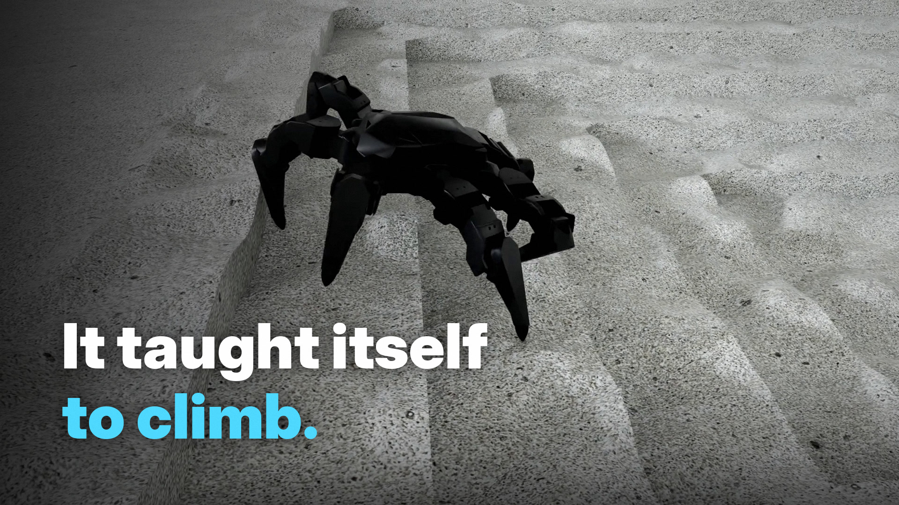

# hexasim

A six-legged robot (Interbotix PhantomX Mark IV, 18 AX-12A servos) that learns to walk and climb **from scratch** in
Isaac Lab with PPO. There is no scripted gait, and the gait clock is annealed out during training. This repo holds the
baseline arms of an upcoming VP-JEPA paper: the policies that the vision model will be compared against.

[](docs/media/hexasim_brag_1080p.mp4)

▶ **[Watch the 62 s demo (1080p, 26 MB)](docs/media/hexasim_brag_1080p.mp4)**: oracle policy, O-geo seed 43, iteration
6,999. The footage uses uniform friction (a showcase setting). Every number on screen comes from the standard evals.

## Where the project stands (2026-10-16)

| Phase | What | Status |
| --- | --- | --- |
| 1 | Flat-ground CPG-guided PPO, pure proprioception | done (history: `research/hexapod-RL-tuning-guide.md`) |
| 2.0–2.1 | **S0**: AX-12A servo model with dropped reads, deployable 111-D observation, commands, terrain curriculum, domain randomisation, mirror augmentation | done. π_S0 trained from scratch; every gate passes with 0 falls in 17,408 episodes |
| 2.2 | **S1** blind trunk: spatial terrain materials, aux velocity / probe learner, 1,125-D union actor layout, 5 seeds | done. All 5 seeds pass every gate, 0 falls in 21,760 episodes |
| 2.3 | **Headroom test**: oracle (O-geo, 144-D height map H\*) vs blind (B0) on terrain up to the robot's physical limit | five-seed result in (below); +4,000-iteration extension running |
| 3 | VP-JEPA (arm F) and the vision baselines | design stage; starts after the headroom gate |

### Headroom test, 5 paired seeds (S1H4, 4,000 iterations, 0.15 m/s, 256 episodes per cell)

Both arms branch from one blind checkpoint. The clock and the clock-phase rewards are annealed out. Stairs go up to
15 cm and gaps up to 14 cm.

- **Gate 1 (the oracle uses H\*): pass.** Hiding H\* drops its pass rate on 9.3 cm stairs from ≈ 0.8 to ≤ 0.16 in every seed.
- **Gate 2 (pre-registered, oracle − blind): inconclusive.**

| Statistic | Mean [95 % CI] | Pre-registered rule | Outcome |
| --- | --- | --- | --- |
| Risers crossed, stairs up L14–26 | **+0.62 [+0.39, +0.85]** | go ≥ 1.0, no-go < 0.5 | inconclusive |
| Gap rings crossed, L10–18 | +0.38 [+0.27, +0.48] | go ≥ 0.5 | not met |

| Mean pass rate | Oracle | Blind |
| --- | --- | --- |
| Stairs 11.3 cm | 0.68 | 0.52 |
| Stairs 13.3 cm (≈ the static reach limit) | 0.56 | 0.20 |
| Gap ring 8.6 cm | 0.92 | 0.50 |
| Trench 8.6 cm (never trained) | 0.95 | 0.63 |
| Stairs down, bumps, flat | no difference | no difference |

The oracle's advantage is real (every seed is positive and the CI excludes 0), but it is smaller than the pre-registered
go threshold. The 8,000-iteration extension of all ten runs is a post-hoc second look, not a new verdict. Full log:
`research/phase2-progress.md` §2.3.27–2.3.29.

## Repository

| Path | Contents |
| --- | --- |
| `source/hexasim/` | Isaac Lab extension: envs (`Hexapod-{Flat,S0a,S0b,S1,S1R,S1H4,S2}-v0`), MDP terms, AX-12A actuator model, `S0PPO` / `S1PPO`, aux learner |
| `scripts/rsl_rl/` | `train.py` (`--branch_from`, `--resume … --restore_levels`), evals (`eval_s0.py`, `eval_headroom.py`), `record_gait.py` |
| `scripts/s1h4/` | headroom-test drivers, eval grid, pre-registered analysis (`s1h4_final.py`) |
| `scripts/tests/` | no-Kit and Kit self-checks (terrain, torque / reach envelopes, leg gap, mirror) |
| `research_progress.md`, `research/` | results and the chronological development log |
| `VP-JEPA_Architecture.md`, `VP-JEPA — Shared Training Paradigm & Baseline Specification.md` | design specs |

## Running

```bash
conda activate env_isaaclab && pip install -e source/hexasim
export OPENBLAS_NUM_THREADS=1
# headroom-test arm, branched from the blind S1R checkpoint
python scripts/rsl_rl/train.py --task Hexapod-S1H4-v0 --headless --num_envs 4096 --seed 43 \
  --branch_from logs/rsl_rl/hexapod_s1r/2026-10-05_10-31-40_s1r_B0_seed43/model_3000.pt env.arm=O-geo
# evaluate a checkpoint on the headroom grid, then the paired statistics
scripts/s1h4/s1h4_eval.sh <model.pt> <tag> full ablate
python scripts/s1h4/s1h4_final.py 43,44,45,46,47
```

Isaac Sim 6.0.1 / Isaac Lab 3.0, Python 3.12, one RTX A4000 (16 GB). One 4,000-iteration run takes ≈ 6.5 h. Checkpoints
and logs (`logs/`) are not in the repo.
