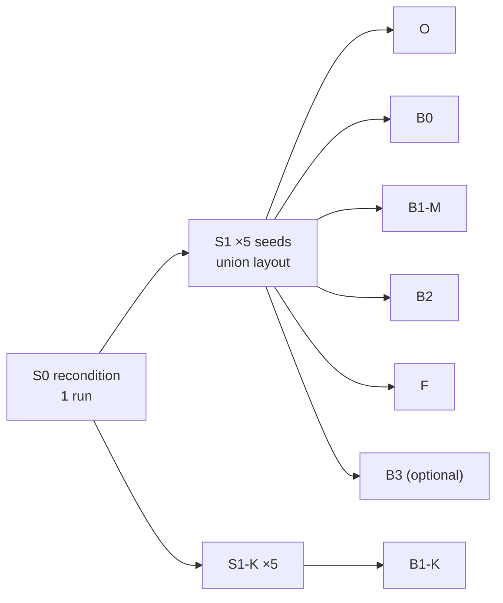

# VP-JEPA — Shared Training Paradigm & Baseline Specification (v2)

2026-09-19 · @Someone

## 0. Verdicts

**One paradigm, no separate replication run.** KiVi is re-implemented under your paradigm in two supervision configurations — B1-K faithful, B1-M matched — and B2 stays the falsification arm. v2 supersedes Training Paradigm v1 and overrides v7 wherever §0.5 says so.

### 0.1 One paradigm or two

A separate “replication” paradigm makes the headline gap unattributable: teacher–student vs single-stage, warm start kept vs overwritten, different reward exposure. No run on an 18-DoF AX-12A hexapod with a 50 Hz bus and RGB-D can be a literal replication anyway. KiVi is itself single-stage asymmetric actor–critic PPO with concurrently trained estimators, and argues against teacher–student error accumulation ([KiVi §III-A](https://arxiv.org/html/2509.23650v2)); a paradigm-matched KiVi is architecture-faithful by construction.

A single combined baseline is not enough either. B1-K alone cannot answer “is your gap just extra supervision?”; B1-M alone cannot answer “did you implement KiVi?”. Both share S0/S1, so the second costs only its S2/S3 runs.

Paper wording: “KiVi re-implemented on our platform under our training paradigm.” Never “replication”.

| Technique | Verdict | Reason |
| --- | --- | --- |
| Teacher–student + DAgger (Lee 2020, Miki 2022, Robot Parkour Learning) | Not run | Regresses onto teacher actions, overwriting the warm-started gait, and adds a second paradigm. Supplementary only if a reviewer insists |
| RMA (Kumar 2021) | Not run | Two phases with a privileged encoder in the actor path; nothing here needs one |
| ROA (Fu, Cheng, Pathak 2022) | Not applicable | No deployable actor consumes a privileged encoder (§3.6) |
| Concurrent estimation + asymmetric critic (Ji 2022, DreamWaQ, KiVi) | **Adopted — the template** | Single stage, preserves the warm start, and is KiVi's own paradigm |
| Kickstarting KL anchor (Schmitt 2018) | ~~Adopted, S1 → first 10 % of S2~~ **Void since 2026-09-23** (warm start dropped, §4.2 outcome; §4.4 kept for the record) | Was gait insurance for a warm-started actor; with π\_S0 trained from scratch there is no lineage to anchor to |
| Residual policy | Fallback only | Caps the ceiling and reads as a bolt-on. If used for one arm, used for all |
| World-model perception (WMP, Lai 2025) | Prior art to position against; optional arm B3 | Nearest mechanism competitor, below |
| Symmetry augmentation / mirror loss | Not adopted | Pulls an asymmetric warm start toward symmetry; mirrored RGB is physically exact only if the colour optical centre sits on the sagittal plane |

**Positioning gap in v7 §1.** KiVi is the nearest *system* competitor, but the nearest *mechanism* is [WMP](https://arxiv.org/abs/2409.16784): a Dreamer-style recurrent world model over depth and proprioception whose recurrent state drives the policy, trained without teacher–student. Its ablation credits predicting proprioception with capturing physical properties of the environment. PIE (RA-L 2024) also predicts the next observation in a single stage. Neither appears in v7's prior-art table, and a reviewer will raise WMP first.

The distinction to defend, stated operationally:

1. Explicit multi-horizon future latents (60/200/400 ms) consumed as policy tokens, not a filtered recurrent belief.
2. A non-generative target (EMA latent), not observation reconstruction.
3. Conditioned on appearance sampled at the predicted touchdown point.
4. Supervised toward contact physics — friction, compliance — which has no geometric signature.

Item 2 is testable at matched architecture by B3 (§2.8).

### 0.2 Errors in your request

Your message repeats v1's E1–E8 almost verbatim, including the pasted paradigm landscape. Those corrections stand; delete that block from your notes.

| # | Your statement | Verdict | Correction |
| --- | --- | --- | --- |
| E1 | ROA = “Zhuang 2023, Robot Parkour” | Still wrong | ROA is Fu, Cheng, Pathak, *Deep Whole-Body Control*, CoRL 2022. Robot Parkour Learning (Zhuang, Fu, Wang, Atkeson, Schwertfeger, Finn, Zhao, CoRL 2023) distils specialist skills into one vision policy. Extreme Parkour (Cheng, Shi, Agarwal, Pathak) is the locomotion paper that uses ROA |
| E2 | Concurrent estimator training = “Fu 2022” | Still wrong | Ji, Mun, Kim, Hwangbo, RA-L 2022. Fu et al. CVPR 2022 is vision–proprioception fusion for navigation |
| E3 | “Copy ROA for the privileged prober” | Misapplied | Nothing to regularise (§3.6) |
| E4 | Photoreal rendering is “where the JEPA addition will shine” | Still wrong | The claim is temporal. An effect that scales with renderer fidelity measures the renderer (§7.1) |
| E5 | Baselines need privileged information “another way” | Still wrong | Same channels, same targets, every arm (§3) |
| E6 | TCN over 5–10 steps | Rejected; you already settled on 50 | §9.1, with corrected reasoning |
| E7 | Add velocity and acceleration | Present, privileged, or harmful | §9.2 |
| E8 | “Retraining from scratch required” | False | E\_p is new at S1; inputs are widened function-preservingly (§4.3) |
| E9 | “No need for ray tracing; real-time rendering is enough” | Decision right, terminology wrong | Every Omniverse RTX mode ray-traces; the current Real-Time 2.0 mode is itself path-tracing-based with DLSS ([NVIDIA](https://docs-prod.omniverse.nvidia.com/materials-and-rendering/latest/rtx-renderer.html)). You are excluding the Interactive (Path Tracing) mode, and you inherit a temporal denoiser to control (§7.4) |
| E10 | Depth-first rendering is “needed for converging” | Wrong reason | Locomotion converges blind; your base policy proves it. Depth-first exists for throughput and to train FAH and sampling geometry before appearance |
| E11 | KiVi = “reactive fusion without lookahead” (your notes; v7 §1: “same sensors, same problem”) | Wrong, and v1-E9 already said so | KiVi predicts the next-step observation and claims anticipation of upcoming obstacles. It is depth-only and targets geometry and visual robustness, not friction or compliance |

### 0.3 Errors in v1

| # | v1 location | Error | Correction |
| --- | --- | --- | --- |
| V1-1 | References | Robot Parkour Learning and Extreme Parkour author lists are wrong — copied verbatim from KiVi's own reference entries \[27\] and \[28\], which are themselves wrong | Correct lists in §13. Never lift a bibliography from a competitor's reference list |
| V1-2 | D4, §6.3a | Called PTFE specular | Virgin PTFE is diffuse (v7 §5.3 fixed this). D4 holds only for water film and polished surfaces |
| V1-3 | §2.2 Oracle | Actor observes material at each foot's *next* touchdown, and the time to it | Non-causal: the next touchdown depends on the Oracle's own future actions and does not exist at step t. Replaced by action-independent scandots (§2.2) |
| V1-4 | §2.4 B1-K | Gave KiVi's token width 32, 3 memory tokens, 2 layers, 1 head, FFN 128 | KiVi's text states none of these. Verify against its Fig. 2 or code; otherwise report them as your choices |
| V1-5 | §4.4 | β₀ set so L\_KL is 10–20 % of the surrogate “at the start” | Undefined: widening makes π\_θ ≡ π\_S0 at the start, so KL = 0. Replaced by adaptive β (§4.4) |
| V1-6 | §6.5 | “Crop reduces horizontal FOV from \~87° to \~71°” | 87° is the depth FOV. The colour-aligned frame has the RGB FOV, 69° × 42°; the crop takes it to \~55°. Crop removed (§7.5) |
| V1-7 | §3.2–§3.4 | Heteroscedastic NLL presented as ROA's analogue with no downside | Its 1/σ² mean-gradient scaling starves the RGB path exactly when RGB arrives. Replaced by β-NLL (§3.3) |
| V1-8 | §8.1 | “A 10-step window cannot contain phase” | Overstated: on a periodic gait the instantaneous (q, q̇) nearly fixes phase. The 50-step decision stands on other grounds (§9.1) |
| V1-9 | §1, §2.2 | Blind arms in S2/S3 not pinned to the vision arms' env count | Equal env steps and equal updates require equal batch; all arms run S2/S3 at N\_v (§1) |
| V1-10 | §5, §9 | 4,096 envs everywhere; 20 vision runs never budgeted | Your hardware is one RTX A4000 16 GB. Budget arithmetic and cut order in §10.2 |
| V1-11 | §7.3 | \~150 floats per buffered step | Undercounts labels; \~340 floats (§8.3). Still small |
| V1-12 | §1, §6, §8.1 | S0/S1 rollout stated as 8,192 × 24, “measured blind optimum” | The base run used 16 steps per env and was undocumented. S0/S1 = 8,192 × 16 until a sweep says otherwise |

### 0.4 Defects in v7 surfaced by this pass

| # | v7 location | Defect | Severity | Fixed in |
| --- | --- | --- | --- | --- |
| A1 | §4.10 | Critic reads physics at the *actual* touchdown location. That is hindsight information caused by a\_t … a\_{t+k}: an action-dependent baseline, which biases the policy gradient. [Mesnard et al. 2021](https://proceedings.mlr.press/v139/mesnard21a.html) keep hindsight inputs free of action information for exactly this reason. At a boundary the critic already knows which side the foot landed on, and absorbs the credit for the anticipatory placement | Critical | §3.5 |
| A2 | §4.10 | Also not computable: at 0.8 Hz a stance leg's next touchdown is ≥ 31 steps away, beyond the end of a short rollout for every sample, so ≥ 3 legs per sample have no value at update time | Critical | §3.5 |
| A3 | §3.2, §4.4 | Coverage uses the depth vertical half-angle (29°). The RGB sensor — the friction modality — is 69° × 42° ([Intel](https://intelrealsense.com/depth-camera-d435)), and colour-aligned depth inherits it. At h 0.22 m, pitch 40°, the near edge moves from 0.085 m to 0.122 m: front footholds at 0.10–0.12 m fall outside the frame | High | §7.5 |
| A4 | §2.1 vs §2.5 | Clock-phase reward terms kept at 10–15 % floors after the clock leaves the observation. By v7's own §2.1 argument, a policy cannot align to an unobserved, per-env-jittered phase, so the floors become reward noise instead of clearance shaping | High | §5 |
| A5 | §4.13 | λ\_priv = 0 in Stage 1, then cosine → 0 over the last 40 % of S3. Under λ\_rl\_enc = 0 only auxiliary losses shape the encoders, so the anneal frees nothing for the policy; it removes the physics anchor and drifts latents late. In B2 the probe is Φ's only gradient, so Φ freezes while F's P keeps training | High | §3.4 |
| A6 | §4.2, §9A | Window still 25 steps although you settled 50. §9A's “RF 63” assumes one conv per block; v1's “RF 61” assumes two. The block is unpinned, so the actual RF is unknown | Medium | §9.1 |
| A7 | §4.3 | v\_kin needs a stance set; its source is unspecified. Using the contact switches would put the lead-time instrument inside the controller | Medium | §2.1 |
| A8 | §4.11 | Future probe “at the predicted touchdown location from ẑ^{t+k}” contradicts v1-D6 and leaves the head's input undefined | Medium | §3.2 |
| A9 | §5.7 | Real-time renderer mode unpinned. Real-Time 2.0 uses a DLSS temporal denoiser: ghosting under fast yaw and history bleed across tiled-env resets are sim-only artifacts | Medium | §7.4 |
| A10 | §4.2 | Joint-velocity filter still unspecified. Its group delay subtracts from the 60 ms horizon, and it must be frozen before S0 because π\_S0 is trained on it | Medium | §1 |
| A11 | §2.1 | Per-step clock dropout makes the TCN see clock flicker inside one window, a pattern deployment never produces | Low | §5 |
| A12 | §4.10 | Critic defined both as “actor observation + privileged” and as an “own encoder over raw privileged and proprioceptive state” | Low | §3.5 |
| A13 | §2.6 | Clearance terms use the tibia-link origin, with +0.0892 compensation valid only at rest pose. The toe-vs-origin error reaches \~16 mm at 10° of tibia pitch | High | §1, §5 |
| A14 | §5.3–5.4 | PhysX friction combine mode unspecified. The default averaging with the foot material compresses the sampled friction range | High | §1 |
| A15 | v2 §11 | The staleness-injection test delays ẑ but not v\_ℓ ⊙ m\_ℓ. Redundant anticipation through v\_ℓ can flatten the response even when P works | High | §11 |
| A16 | §4.2 | E\_p's input includes previous actions, so z̄^{t+k} encodes the policy's own future actions. The JEPA target is policy-dependent | Medium | §2.7, §2.8 |

### 0.5 Precedence

| Topic | v1 | v7 | v2 decision |
| --- | --- | --- | --- |
| Probe weight | Constant S1–S3 | 0 / moderate / max / cosine → 0 | Constant from S1, β-NLL, no terminal anneal (§3.3–3.4) |
| Probe touchdown location | Ground truth | Predicted | Ground truth; head reads the concatenated output tokens (§3.2) |
| Critic physics | Unspecified | Actual touchdown | Action-independent material scandots (§3.5) |
| Critic network | Same for all arms | Separate | Separate; input = sg\[actor obs\] ⊕ fixed contract P (§3.5) |
| TCN window | 50 | 25 | 50, RF asserted ≥ 50 (§9.1) |
| Velocity estimator | \[v̂, f̂\] | Residual v\_kin + Δv̂ | Residual + f̂; FK stance set (§2.1) |
| Staleness input | latent\_age | rem\_60/200/400 + 150 ms cutoff | v7, every vision arm (§2.9) |
| Dropped reads | — | ZOH + 18-bit mask, load-correlated | v7, every arm including B1-K (§1) |
| Auxiliary-loss data | 128-step ring buffer | FIFO + episode masking | Both (§8.3) |
| Image geometry | Crop to 640 × 480 | — | No crop; colour FOV; anisotropic resize (§7.5) |
| Renderer | Real-time, no path tracing | Same | Mode pinned; temporal-artifact tests (§7.4) |
| KL anchor | β₀ undefined | Not specified | Adaptive β, same end point (§4.4) — **void since 2026-09-23** |
| CPG floors | Inherited | Clock-phase floors | Phase-free, contact-conditioned (§5) |

## 1. Invariants — identical for every arm

**Every arm shares everything in this table; an arm may differ only in the deltas named in §2.** Rows marked *new* did not exist in v1.

| Item | Specification | Why |
| --- | --- | --- |
| Robot asset | Same USD, including camera mast mass and inertia, for blind arms too | Otherwise B0 vs vision is confounded by payload |
| Actuator | v7 §5.1: P-only at measured gain, compliance margin/slope, saturation, velocity falloff, 10-bit quantisation, backlash, deadband, 4–12 ms bus latency | Tracking error is a torque proxy only if the servo model is faithful |
| Dropped reads *(new)* | Per-servo drops with probability rising with commanded torque or tracking error; ZOH of q and of the last valid q̇; 18-bit validity mask in every per-step input, B1-K's kinesthetic history included; one fill implementation for sim and robot | v7 §4.2a. Drops concentrate on rough terrain; an arm that never sees them is off-distribution exactly there |
| Joint velocity *(new, closes A10)* | Two-sample backward difference of ZOH-filled, quantised positions: q̇\_t = (q\_t − q\_{t−2}) / 2Δt. If either endpoint is a held value, hold the last valid q̇. No recursive filter. Quantum 0.128 rad/s, group delay 20 ms. Frozen before S0 | A one-sample difference halves the delay but doubles the quantum (0.256 rad/s). A recursive filter adds delay the 60 ms horizon cannot afford. π\_S0 bakes this choice in |
| Rewards | v7 §2 set with the §2.2/§2.3/§2.6 fixes; anneal and floors per §5 of this document | — |
| Training algorithm *(new)* | PPO with left–right mirror data augmentation (rsl\_rl `symmetry_cfg`, augmentation only): reflection y → −y, legs RF↔LF, RM↔LM, RB↔LB, coxa angle/rate/action sign flipped, femur and tibia kept, axial quantities (ω, yaw command) negated, per-leg blocks permuted (the tripods swap = the clock shifted by π). On from S0b for every arm; mapping verified against the simulator to < 1 mm toe error (research/phase2-progress §2.1.27) | The platform is mirror-symmetric but the π\_base lineage was not: it turned one way and stood on one side. An arm trained without it would carry a different asymmetry into the comparison |
| Terrain | One generator, one material library (v7 §5.4, matte-slippery and shiny-grippy entries included), one set of transition profiles, one curriculum. Training uses levels 0–14 of the 15-level generator (level 14: rough ±2.25 cm, slopes 15°, bumps 3 cm, stairs 3 cm risers — the ceiling the 3.8 cm swing height allows); levels 15–20 are evaluation-only (§10.4) | — |
| Dynamics randomisation | v7 §5.6 in full, including rolling shutter and specular depth dropout | — |
| Critic | Separate network, same architecture; input sg\[actor obs\] ⊕ privileged contract P, with P identical for all arms (§3.5) | Value quality must not differ by privileged content |
| Probes | Universal probe set (§3.2), β-NLL, constant weight — B1-K excepted by design | Equal supervision budget |
| Warm start | **Removed 2026-09-23** (§4.2 control-arm outcome): every arm starts from π\_S0, which is itself trained from scratch; no KL anchor (§4.4 is void). Widening per §4.3 still applies at S1 | The blind from-scratch control passed the S0b gates at 0.30 × the warm-start budget, so the warm start bought nothing and would only carry the π\_base lineage's asymmetries into every arm |
| Envs and batch *(new)* | S0/S1: 8,192 × 16 (base run; unverified optimum). S2/S3: N\_v envs × T\_v steps for **every** arm, blind arms included, with N\_v·T\_v ≥ 24,576 | Equal env steps and equal updates imply equal batch. Otherwise B0 at 8,192 envs gets a 16× larger batch than a vision arm at 512 |
| Camera, vision arms | Colour intrinsics (§7.5); extrinsics ±2° / ±5 mm; 30 Hz, rendered on camera ticks only (§7.3); latency up to the measured hardware p99, with drops; rolling shutter; depth corruption (§7.3); one image operator (§7.5). B1-K also at 30 Hz | Platform properties, not method parameters |
| Staleness, vision arms *(new)* | rem\_60, rem\_200, rem\_400 and the 150 ms vision-loss cutoff (v7 §4.9a) | Asynchrony is a platform property; an arm without these features is handicapped by an unmodelled input |
| Modality dropout | v7 §5.5 rates, vision arms | — |
| Contact switches *(new)* | Instrumentation only — never an actor, critic or estimator input | Keeps the lead-time instrument independent of the controller; no switch model needed in sim |
| Seeds | Paired branching (§10.1) | — |
| Toe point *(new)* | toe\_pos\_w = tibia\_pos\_w + R(tibia\_quat\_w)·(0.095, 0, −0.09) m (URDF foot\_link) for every reward, label, anchor and v\_kin. No hard-coded height constants | A13 |
| Friction combine *(new)* | Foot material μ = 1.0 with combine mode multiply (or both min); effective μ equals the sampled ground μ, verified by a sim sliding test | A14 |
| Commands *(new)* | twist\_cmd (3), zero-init, introduced in S0b. Training: v\_x \~ U\[0.05, 0.20\] m/s with 10 % zero-command episodes; 30 % of episodes add small v\_y and yaw-rate commands. Evaluation (ablations): v\_x ∈ {0.10, 0.15}, v\_y = yaw = 0 | Option (a) keeps the secondary experiment (v\_y, yaw, position-PID cascade) possible without retraining |
| Clock reference *(new)* | f\_ref = clamp(v\_cmd,x / 0.20, 0.8, 2.5) Hz, from the command, not measured vx | Removes slip coupling from the reward reference; pinned at 0.8 Hz across the evaluation range |

## 2. Arms

**Six arms plus one optional control; B2 and F differ by exactly {horizon-indexed queries, L\_jepa, L\_inv, EMA target}.** That contrast is the falsification test and is settled; nothing in v2 changes it.

| Arm | Role | Vision | Foothold attention | Future prediction | Seeds | Hardware |
| --- | --- | --- | --- | --- | --- | --- |
| **O** Oracle | Headroom upper bound, sim only | None; ground-truth material strips in the actor | — | — | 5 | No |
| **B0** Blind | Proprioceptive floor | None | No | No | 5 | Yes |
| **B1-K** KiVi-faithful | Named competitor, re-implemented | Depth | No | Next-step observation (VAE) | 5 (first cut to 3 if compute is short, §10.2) | Optional |
| **B1-M** KiVi-matched | Supervision-matched competitor | RGB-D | No | Next-step observation (VAE) | 5, floor 3 | Recommended |
| **B2** Foothold-attended | Falsification of the claim | RGB-D | Yes | None | 8 target, 5 hard floor | Yes |
| **F** VP-JEPA | Full model | RGB-D | Yes | Multi-horizon latent (JEPA) | 8 target, 5 hard floor | Yes |
| **B3** Generative-target *(optional)* | Why a latent target? | RGB-D | Yes | Multi-horizon, observation space | Dropped unless compute remains (§10.2) | No |

### 2.1 Shared modules

- **E\_p** — dilated TCN on the v7 §4.2 per-step input: 111 dims in S1, 99 live after the clock anneal, 18 of them the read-validity mask. Window W = 50; RF asserted ≥ W at construction (§9.1). Output z\_p ∈ R^64 with LayerNorm.
- **V** — v7 §4.3 residual form plus contact forces: ê = \[v̂\_b, f̂\]. v̂\_b = v\_kin + Δv̂ with Δv̂ = MLP(z\_p). f̂ ∈ R^{6×2} holds per-foot normal and tangential force magnitudes, surface-normal projected. Huber losses; Δv slip-weighted.
- **v\_kin stance weights (closes A7)** — per foot, w = σ((|e\_femur| + |e\_tibia| − τ\_e)/s) × σ((z̄\_plane − z\_toe + δ)/5 mm). e is the tracking error, i.e. stance-load sag under P-only control; z̄\_plane is a plane fitted to all six toes in the body frame. τ\_e, s and δ are calibrated on the bench (v7 item 14). Each weighted foot gives v\_b = −(J\_ℓ q̇\_ℓ + ω × p\_ℓ) at the toe point (§1); v\_kin is the weighted mean. Gravity-frame “three lowest feet” is rejected: it picks one side on cross-slopes and upper-level feet on step-downs. No switches.
- **E\_v** — v7 §4.4 stem, shared by B1-M, B2, F and B3. B1-K uses the same stem on the depth and validity channels only.
- **FAH, sampling, contact memory CM** — v7 §4.5, §4.6, §4.8; in B2, F and B3 only. FAH receives no gradient from downstream losses (stop-gradient on p̂ into sampling, §8.2).

### 2.2 O — Oracle (sim only)

**Actor:** \[o\_p, z\_p, ê, twist, M\*\]. M\* is a privileged material strip per leg: 8 × 3 points (forward −6 to +15 cm, lateral ±3 cm, 3 cm spacing) anchored at that leg's nominal foothold in the body frame. Each point carries (μ\_s, μ\_d, log k, log c): 6 × 24 × 4 = 576 dims.

M\* is computed from the current base pose and terrain, so it is causal and action-independent (fixes V1-3). The strip reaches +15 cm because the 400 ms-horizon landing point sits at most \~11 cm ahead of nominal at 0.15 m/s: 6 cm of travel plus \~5 cm to the front of the stroke. Height is deliberately excluded, so O vs B0 isolates the value of knowing the *material* ahead. The nominal foothold is the rest-pose toe position in the body frame (fixed, clock-independent).

**Purpose:** O is anticipatory by construction. If O ≈ B0 on transition terrain, anticipation has no value on this task and every vision run is wasted. O branches at S2 from the shared S1 (§10.1), which makes O–B0 a paired comparison; it runs S2/S3 at N\_v envs without rendering.

### 2.3 B0 — Blind

Actor \[o\_p, z\_p, ê, twist\]. Losses: L\_est, L\_probe (current and touchdown heads both on z\_p), L\_vic.

### 2.4 B1-K — KiVi re-implemented

Verified against [KiVi v2](https://arxiv.org/html/2509.23650v2). Anything KiVi's text does not state is marked as a re-implementation choice.

| Element | KiVi as published | B1-K here |
| --- | --- | --- |
| Paradigm | Single-stage asymmetric actor–critic, PPO, concurrent estimator; argues against teacher–student | Same, warm-started from π\_S0 |
| Actor input | 45-D proprio (ω, gravity, command, θ, θ̇, a\_{t−1}) + 31-D kinesthetic (ê 11 + z 20) + 20-D visuospatial (z\_s 12 + z\_F 8) | Hexapod o\_p (§1 per-step frame) + ê + z\_K + z\_s + z\_F + staleness features |
| Kinesthetic module | History o\_{t−10:t}; ê = base linear velocity + foot contact forces in x and z (MSE); z ∈ R^20 predicts o\_{t+1} VAE-style | 10-step history kept; ê = 3 + 6 × 2 = 15; z\_K ∈ R^20. Encoder architecture not stated in the text → MLP, reported as a choice |
| Visuospatial module | Proprio token = kinesthetic-MLP features → stop-gradient → MLP (Fig. 2, red line); 2 depth frames → CNN → 16 tokens; MemTransformer with fed-back memory m\_t; outputs l\_state, l\_vis → MLP → z\_s, z\_F | Proprio token = kinesthetic-MLP features → stop-gradient → MLP; 2 depth + validity frames → shared stem → 16 tokens; MemTransformer with fed-back memory; l\_state, l\_vis → MLP → z\_s, z\_F. Widths and token counts reported as choices |
| Visuospatial targets | Global surrounding elevation ŝ and per-foot local heights F̂, L1 loss | Same, 6 feet |
| Estimator loss | KL + MSE(ê) + MSE(ô\_{t+1}) + L1(ŝ) + L1(F̂) | Same |
| Critic | Base velocity, o\_t, 8 contact forces, height scan | Privileged contract P (§3.5), a platform invariant |
| Gradient blocking | Fig. 2: blocked (i) estimator → actor, (ii) kinesthetic MLP → visuospatial MLP | Identical to λ\_rl\_enc = 0; no deviation |
| Depth rate | 10 Hz | 30 Hz (platform) |
| Not given | — | RGB, FAH, CM, universal probe set |

Eq. 5 writes q(z\_t | o^H, d); Fig. 2 shows no depth path to z\_t, so z\_K is proprio-only.

B1-K branches from its own S1-K, because its encoder is not E\_p. KiVi's published setup — Lite3 quadruped, D435i, Orin NX, 4,096 envs, \~12,000 iterations, \~8 h on an RTX 4090 — is context, not a target.

### 2.5 B1-M — KiVi-matched

B1-K with exactly four changes:

1. Shared E\_p + V replace the kinesthetic module; the actor reads z\_p; the VAE o\_{t+1} head sits on z\_p as an auxiliary. The visuospatial proprio token is built from sg\[E\_p features\] through an MLP, mirroring Fig. 2's blocked link.
2. RGB-D through the shared E\_v stem, 48 tokens.
3. memTransformer width set so visuospatial module + heads are within ±15 % of the parameter count of F's FAH + sampling + P + CM.
4. Universal probe set added; the touchdown head reads the pooled memTransformer output.

Still no foothold attention, no FAH, no CM, no multi-horizon prediction. Branches from the shared S1.

### 2.6 B2 — foothold-attended, no predictor

E\_p, V, E\_v, FAH, sampling and CM are identical to F. Fusion Φ is architecturally identical to P — 3 cross-attention layers, d = 128, 4 heads, same keys and values including CM tokens — with 3 learned queries carrying no horizon semantics. Outputs u\_1…u\_3 ∈ R^64 occupy F's ẑ slots.

Losses: L\_est, L\_fah, L\_probe (current head on z\_p, touchdown head on concat(u\_1, u\_2, u\_3)), L\_vic. No L\_jepa, no L\_inv, no EMA target. B2 receives the same rem\_k features as F; they are affine in latent age, so both arms carry identical staleness information.

### 2.7 F — VP-JEPA

v7 §4 with the v2 overrides: touchdown probe head on concat(ẑ^{+60}, ẑ^{+200}, ẑ^{+400}) (§3.2); β-NLL at constant weight (§3.3–3.4); critic contract P (§3.5); V residual + f̂ (§2.1).

**Diagnostic (A16):** a linear probe from ẑ^{+400} to a\_{t+19}. Report R². High R² means part of the anticipation is self-prediction.

### 2.8 B3 — generative-target control (optional)

F with one change: L\_jepa's target sg\[z̄\_p^{t+k}\] is replaced by the standardised raw frame o\_p^{t+k}, decoded from ẑ^{t+k} by a 2-layer MLP. The EMA target is removed; L\_inv reads a stop-gradient online z\_p^{t+k}.

B3 answers “why a latent target instead of a WMP-style reconstructive predictor?” at matched architecture and inputs. It tests target space, not WMP's full recipe, and needs no pixel decoder.

Target restricted to the q, q̇, tracking-error and IMU dims of o\_p^{t+k}. Action, mask and clock dims are excluded, since predicting a\_{t+k−1} is policy cloning (A16).

### 2.9 Actor observation layouts

Dims are per block. S1 uses the union of all layouts except B1-K's, with unused blocks held at exactly zero (§10.1).

| Block | Dims | O | B0 | B1-K | B1-M | B2 | F | B3 |
| --- | --- | --- | --- | --- | --- | --- | --- | --- |
| o\_p — per-step frame incl. mask; clock zero after S2 | 111 | ✓ | ✓ | ✓ | ✓ | ✓ | ✓ | ✓ |
| z\_p | 64 | ✓ | ✓ | — | ✓ | ✓ | ✓ | ✓ |
| z\_K | 20 | — | — | ✓ | — | — | — | — |
| ê = \[v̂\_b, f̂\] | 15 | ✓ | ✓ | ✓ | ✓ | ✓ | ✓ | ✓ |
| M\* material strips | 576 | ✓ | — | — | — | — | — | — |
| z\_s, z\_F | 20 | — | — | ✓ | ✓ | — | — | — |
| Three output tokens | 192 | — | — | — | — | u | ẑ | ẑ |
| v\_ℓ ⊙ m\_ℓ for L1, R1 | 128 | — | — | — | — | ✓ | ✓ | ✓ |
| m\_ℓ | 2 | — | — | — | — | ✓ | ✓ | ✓ |
| σ̂\_ℓ as log-σ of (x, y, z, Δt) | 8 | — | — | — | — | ✓ | ✓ | ✓ |
| rem\_60, rem\_200, rem\_400 | 3 | — | — | ✓ | ✓ | ✓ | ✓ | ✓ |
| twist\_cmd | 3 | ✓ | ✓ | ✓ | ✓ | ✓ | ✓ | ✓ |

## 3. Privileged-information accounting

**Privileged information reaches every arm through the same three channels — critic contract P, explicit estimate targets, universal probe set — with identical targets.** F's only extra training signal over B2 is self-supervised; state that sentence verbatim in the paper.

### 3.1 Channels

| Channel | O | B0 | B1-K | B1-M | B2 | F | B3 | Deployed? |
| --- | --- | --- | --- | --- | --- | --- | --- | --- |
| Critic contract P | ✓ | ✓ | ✓ | ✓ | ✓ | ✓ | ✓ | No |
| Explicit targets (Δv, f) | ✓ | ✓ | ✓ | ✓ | ✓ | ✓ | ✓ | Estimator yes, labels no |
| Universal probe — current | ✓ | ✓ | — | ✓ | ✓ | ✓ | ✓ | No |
| Universal probe — next touchdown | ✓ | ✓ | — | ✓ | ✓ | ✓ | ✓ | No |
| KiVi heads ŝ, F̂ and VAE o\_{t+1} | — | — | ✓ | ✓ | — | — | — | No |
| FAH contact labels | — | — | — | — | ✓ | ✓ | ✓ | No |
| JEPA targets z̄\_p^{t+k} | — | — | — | — | — | ✓ | — | Not privileged: EMA of a deployable encoder |
| Observation targets o\_p^{t+k} | — | — | — | — | — | — | ✓ | Not privileged |
| Ground-truth material in the actor | ✓ | — | — | — | — | — | — | Never; O is sim-only |

- FAH's touchdown labels are also inside the probe set, so B0 and B1-M receive the same label information; B2 and F merely route it through a deployed head.
- O now carries the full probe set (v1 had “in obs”), so its E\_p trains exactly like B0's.
- B1-K is deliberately under-supervised relative to the rest. That is why B1-M exists; report both.

### 3.2 Universal probe target set (sim only)

| Group | Per leg ℓ, × 6 | Dims |
| --- | --- | --- |
| Current | Contact state (BCE) | 6 |
| Current | μ\_s, μ\_d, log k, log c under the foot | 24 |
| Current | Local height, 3 × 3 grid, 4 cm, body frame | 54 |
| Next touchdown | Touchdown position p^TD, body frame | 18 |
| Next touchdown | Time to touchdown Δt^TD | 6 |
| Next touchdown | μ\_s, μ\_d, log k, log c at the **ground-truth** touchdown location | 24 |
| Next touchdown | Local height 3 × 3 at the ground-truth touchdown location | 54 |
| **Total** |  | **186** |

- **Location (closes A8):** ground truth, not FAH's prediction. v7 §4.11's “predicted touchdown location” is overridden; labels must be arm-independent.
- **Head inputs:** the current head reads z\_p in every arm except B1-K. The touchdown head reads z\_p (O, B0), the pooled memTransformer output (B1-M), concat(u\_1, u\_2, u\_3) (B2), or concat(ẑ^{+60}, ẑ^{+200}, ẑ^{+400}) (F, B3). Same head everywhere: 2-layer MLP, 256 hidden.
- **How physics reaches the horizon tokens:** L\_jepa trains ẑ^{t+k} to match a future z\_p, and z\_p is shaped by the current-state probe. The touchdown head over the concatenation keeps B2 and F on identical targets.
- **All six legs:** the trailing-leg targets supervise the proprioception-propagated half of the cascade.
- **Resolution:** touchdown targets are written retroactively in the sequence buffer (§8.3); samples whose touchdown lies past an episode end are masked.

Hindsight labels are fine for a supervised auxiliary. The same quantity is not acceptable as a critic input (§3.5), because a baseline must not depend on the action.

### 3.3 Probe loss — β-NLL

```latex
\mathcal{L}_\beta = \operatorname{sg}\!\left[\sigma^{2\beta}\right]\left(\tfrac12\log\sigma^2 + \frac{(y-\mu)^2}{2\sigma^2}\right), \qquad \beta = 0.5
```

log σ² clamped to \[−6, 4\]; BCE for contact state; targets standardised with fixed statistics from the S0 rollout (Seitzer et al., ICLR 2022).

**Why plain NLL fails here (V1-7).** Its mean gradient is −(y − μ)/σ². In S2, leading-leg touchdown friction is unobservable because depth ⟂ physics, so σ² grows. When RGB arrives in S3, the gradient that should teach the RGB pathway is scaled by 1/σ² — smallest exactly when it matters.

With β = 0.5 the mean gradient becomes −(y − μ)/σ. Unobservable targets are still down-weighted, which keeps v1's “don't force what the observations cannot determine” property, but the suppression is halved in log scale.

**Check:** leading-leg touchdown-friction σ must fall within the first 30 % of S3. If it does not, the RGB pathway is not learning, whatever the return curve says.

### 3.4 Probe weight schedule — overrides v7 §4.13

**λ\_probe is constant from the start of S1 to the end of S3, identical for all arms; touchdown-material terms are weighted 2×.**

1. **S1 = 0 (v7) is wrong.** S1 is where E\_p is born and the actor's z\_p columns start learning. v7's Stage-1 signal would be L\_vel alone — under v7 §4.3 a slip residual that is near zero on most steps. The current-state probe is what gives z\_p proprioceptive physics, the trailing-leg half of the cascade.
2. **The terminal anneal is harmful under λ\_rl\_enc = 0.** No PPO gradient reaches the encoders, so removing the probe releases nothing to the policy. It removes the physics anchor and leaves JEPA and VICReg reshaping latents while the actor converges. In B2 the probe is Φ's only gradient, so Φ would freeze for 40 % of S3 while F's P keeps training — an asymmetric confound.
3. **v7's S3 boost treated a real symptom with the wrong tool.** Suppressed RGB learning is a 1/σ² effect, fixed in §3.3. If a pilot still shows slow RGB uptake, raise the touchdown-material weight in S3 for all arms identically.

Permitted change, from v1: 0.5× over the final 20 % of S3, only if latent drift (§8.4) is shown to limit PPO, applied to all arms.

### 3.5 Critic contract — overrides v7 §4.10

**Separate network; input = sg\[the arm's actor observation\] ⊕ P; P is identical for every arm, computed at step t, and independent of the action.**

| P element | Dims | Note |
| --- | --- | --- |
| True base linear velocity, body frame | 3 |  |
| True base height above local terrain | 1 |  |
| Contact force per foot: normal and tangential, surface-normal projected | 12 | v7 §2.6 projection |
| Contact state per foot | 6 |  |
| Material strips: per leg 8 × 3 points, −6 to +15 cm forward, ±3 cm lateral, anchored at the **nominal** foothold; μ\_s, μ\_d, log k, log c | 576 | Replaces the actual-touchdown query; same definition as O's M\* |
| Height scan around the body, 11 × 7 grid, 5 cm | 77 | Fixed before S1 |
| Dynamics randomisation parameters: k\_p factor, compliance slope, payload, CoM offset (3), bus latency, drop rate | 8 |  |
| **Total** | **683** |  |

The nominal foothold is the rest-pose toe position in the body frame (fixed, clock-independent).

**Why not the actual touchdown (A1).** The actual landing point is a function of a\_t … a\_{t+k}. As a baseline input it makes the baseline action-dependent, which biases the policy gradient; [Mesnard et al. 2021](https://proceedings.mlr.press/v139/mesnard21a.html) keep hindsight inputs free of action information for this reason. At a friction boundary the critic would already know the foot landed on the grippy side, and would absorb the credit for the anticipatory placement — the behaviour under study.

**Why it is not computable either (A2).** At 0.8 Hz a stance leg's next touchdown is ≥ 31 steps away: beyond the end of a 24-step rollout for every sample, and of a 48-step rollout for most. The strips exist at step t, are stationary with respect to FAH (v7's original concern), and cover the 400 ms-horizon landing region.

**Why the actor observation is in the critic (A12).** State-only critics are biased for history-dependent policies ([Baisero & Amato, AAMAS 2022](https://www.khoury.northeastern.edu/home/abaisero/assets/publications/repository/baisero_unbiased_2022.pdf)); conditioning on the agent's own information removes that bias. The actor observation already summarises the arm's history (z\_p, ẑ or u), so it goes in, detached. Critic inputs differ across arms only in each arm's own information; P never differs.

**Implementation.** 3-layer MLP \[512, 256, 128\] with its own normaliser; no module shared with the actor. Unit test: after a value-loss backward pass, every actor-side parameter has grad None. Keep v7's diagnostic (value-loss variance against σ̂\_ℓ should be flat) and v7's rule: judge arms on task metrics, never on value or return curves.

### 3.6 Why ROA does not apply

ROA closes the gap between a privileged encoder the policy consumes in training and an adaptation module it consumes at deployment. No deployable arm here has a privileged encoder in its actor path; every actor reads deployable latents from its first iteration. There is no switch, so there is nothing to regularise.

The transferable idea — do not force a representation to encode what the observations cannot determine — is implemented by the heteroscedastic probe (§3.3). Do not add a privileged encoder to the actor to speed learning: it re-creates the train/deploy switch and the supervision-mismatch objection.

## 4. Warm start from the CPG base policy

**S0 reconditions your CPG policy in two segments — S0a (actuator and observations) and S0b (commands, clock, terrain); its output π\_S0 seeds every arm (widened at S1, §4.3). Update 2026-09-23: the from-scratch control arm (§4.2) removed the warm start, so π\_S0 is itself trained from scratch and is no longer a KL anchor (§4.4 void).**

### 4.1 Stage-0 audit — results for π\_base (model\_14998.pt)

| Item | π\_base | Status |
| --- | --- | --- |
| Actor observation | 75-D, including ground-truth base\_lin\_vel and the 12-D clock; no command input | Fails — non-deployable |
| Joint velocity | PhysX joint\_vel\_rel | Fails |
| Observation noise, domain randomisation | None, none | Fails |
| Terrain, history | Flat, single frame | Fails |
| Actuator | ImplicitActuatorCfg Kp 20, Kd 0.5, effort 3 N·m (≈ 2× AX-12A stall), velocity π rad/s | Fails |
| Control dt | 1/200 × decimation 4 = 50 Hz | ✓ |
| Action | JointPositionAction scale 0.5; default offset coxa 0°, femur +30°, tibia −30°; clip\_actions null | Fails — unclipped |
| Normalisers | Actor and critic normalisers in the checkpoint | Present, but statistics invalid under S0a observations → re-estimated (§4.2) |
| Action std | 0.012–0.025 femur/tibia, 0.09–0.12 coxa | Fails — see §4.3 item 2 |
| Clock | Floor 0.2 Hz; identical phase at reset | Fails |
| Rollout | 16 steps per env | Undocumented (V1-12) |
| Operating point | Mean v\_x 0.209 m/s on flat | Reference for the S0a gates |

Every row of the audit fails except control dt.

**Expect a frequency shift.** π\_base walks at 0.209 m/s, so its reference ran at ≈ 1.05 Hz with ≈ 0.20 m stride per cycle. S0b moves the operating point to 0.10–0.15 m/s on the 0.8 Hz floor, so stride falls to 0.125–0.19 m. Stride is gated against v/f\_ref, not against π\_base.

### 4.2 Stage 0 — S0a and S0b

**Prerequisite:** static torque envelope at rest pose (v7 §5.2, action item 14). If femur stance torque exceeds \~60 % of stall, redesign the rest pose before S0a.

**S0a — actuator and observations, flat terrain.** AX-12A model (v7 §5.1) with dropped reads and mask; §1 velocity pipeline; observation noise; ground-truth v\_x substituted by V\_0 on the 0 → 1 ramp over 50 %; actions clipped to the servo CW/CCW limits; actor std floored at 0.05 (action space) for S0 only; normaliser re-estimated from a 50-iteration burn-in with the actor frozen, then count capped.

Gates, relative to π\_base:

- fall rate within +2 percentage points;
- duty factor 0.5 ± 10 %;
- clearance ±10 %, measured at the toe point;
- coxa power above 5 Hz not increased.

**S0b — commands, clock and terrain.** twist\_cmd (zero-init) and a tracking reward; command distribution per §1; 0.8 Hz floor with f\_ref from the command; per-env phase jitter; easy-to-medium terrain curriculum; phase-free floor terms (§5).

Gates, absolute:

- v\_x tracking RMSE ≤ 0.03 m/s at {0.10, 0.15};
- stride within ±10 % of v/f\_ref;
- fall rate ≤ 5 %;
- tracking at the hardware drop rate within +5 % of drop-free.

The ≤ 0.03 m/s and ≤ 5 % thresholds are proposals; tune them in the pilot.

**Control arm.** One blind from-scratch run through S0a/S0b at the same budget. If it reaches the S0b gates within 1.2× the warm-start env steps, drop the warm start and the KL anchor (§4.4) for all arms.

**Outcome (2026-09-23): the warm start is dropped.** The control arm — random init, final S0b task, same rewards, dynamics randomisation, terrain curriculum, mirror augmentation and batch — passed every S0b gate at 8,000 iterations, i.e. **0.30 ×** the 26,596-iteration warm-start budget (S0a 4,498 + S0b 22,098), far inside the 1.2 × rule: 0 % falls on terrain levels 0/5/9, v\_x cycle RMSE ≤ 0.011 m/s, stride −4.6 … −8.3 %, dropped reads no worse than drop-free. It is also better than the warm-started policy where the lineage was weakest: standing contact duty 0.97 vs 0.80, and symmetric turning (+0.187 / −0.191 rad/s of ±0.3) against the lineage's +0.155 / −0.278. **π\_S0 is therefore this from-scratch policy**, and §4.4's KL anchor is void for every arm. Evidence: research/phase2-progress.md §2.1.30.

Output: π\_S0 and its normaliser. Seed variance is reported from S1 onward, conditional on the shared π\_S0; say so in the paper.

### 4.3 Function-preserving input widening

For the actor's first layer W ∈ R^{h × d\_old}: W′ = \[W | 0\], b′ = b. At initialisation π(o\_old, o\_new) = π\_S0(o\_old) exactly, and the gradient δ·o\_newᵀ is non-zero, so new inputs are learned. “Retraining from scratch” is false.

Each item below is a known way to destroy a warm start silently:

1. **Normaliser:** copy old-dim statistics; estimate new-dim statistics during critic burn-in with the actor frozen, then enable online updates.
2. **Action std:** carry the learned log-std. rsl\_rl's init\_noise\_std default of 1.0 injects exploration noise a converged gait cannot survive. Floor it so it cannot collapse. Exception: S0 floors std at 0.05 in action space. π\_base's femur/tibia std of 0.012–0.025 corresponds to 1–2.5 encoder ticks, which is inside the AX-12A backlash band, so exploration is effectively dead there.
3. **LayerNorm per new block only, never over the concatenated input:** a whole-input LayerNorm changes π the moment dims are added.
4. **Unit test in CI:** over 10,000 observations with random o\_new, max |π\_widened − π\_S0| < 1e-6.
5. **Clock dims** stay in the layout and are zeroed by dropout, never deleted.
6. **Hidden layers unchanged.** Changing actor depth or width is the one change that truly needs retraining.

The actor is widened once, at S1, to the final union layout (§2.9). The critic is not widened: it is a separate network rebuilt at S1 for contract P (§3.5), with the actor frozen during burn-in.

### 4.4 KL anchor — void since 2026-09-23 (kept for the record)

**Not used: the warm start was dropped (§4.2 outcome), so there is no π\_S0 lineage to anchor to.** The design below stands only if a future run reinstates a warm start.

```latex
\mathcal{L}_{KL} = \beta\,\mathrm{KL}\!\left(\pi_{S0}(\cdot \mid o^{\text{anchor}}) \,\big\|\, \pi_\theta(\cdot \mid o)\right)
```

Closed form for diagonal Gaussians. The anchor reads its own observation, including the ground-truth-driven clock; that is legitimate because it is sim-only.

**v1's β₀ rule was undefined.** At S1 start π\_θ ≡ π\_S0, so KL = 0 and “10–20 % of the surrogate at the start” is zero. Replacement:

- **S1, after burn-in — adaptive β against a drift budget d\*.** After each iteration: if KL > 1.5 d\*, β ← 2β; if KL < d\*/1.5, β ← β/2; β ∈ \[10⁻³, 10\], starting at 0.1. Start d\* at 0.05 nats over the 18-D action and tune it in the pilot. For scale, a 0.075σ mean shift on every dimension costs about 0.05 nats.
- **S2:** freeze the adaptation, then decay β linearly to 0 over the first 10 % of S2 — finished while clock dropout is ≤ 33 % (settled).

It must reach zero that early for two reasons. Once the student loses the clock, KL to a clock-conditioned anchor cannot vanish and biases toward clock-averaged actions. And every anticipatory deviation from the tripod is a KL cost.

### 4.5 Residual fallback

Only if S1 fails its gate for ≥ 2 of 5 seeds. If used for one arm, it is used for all.

## 5. Reward schedule across stages

**The clock and every reward term indexed by clock phase leave together; whatever must survive the anneal is re-expressed on measured contact state, which the policy can infer from its own proprioception.**

**The defect (A4).** v7 keeps cpg\_z\_target\_\* at 10–15 % and the stance-rigidity term at a floor after the clock leaves the observation. Per-env phase jitter (v7 §2.3) makes the reference phase unobservable to a clock-blind policy. A phase-matching term's expected value then barely depends on the policy's timing: it adds variance, not clearance shaping — the one job the floor exists for.

| Term | S0 / S1 | S2, first 30 % | Rest of S2, S3 | Why |
| --- | --- | --- | --- | --- |
| cpg\_z\_target\_\* (clock phase) | Full | → 0 | 0 | Unlearnable once the clock is gone |
| **swing\_clearance** *(new, phase-free)* | Floor = 10–15 % of the Stage-1 z\_target weight | Floor | Floor | For each foot out of contact (sim contact sensor), reward peak swing height ≥ h\_c, scored at touchdown. Does what v7's floor intended |
| cpg\_stance\_rigidity (clock phase) | Full | → 0 | 0 | As above |
| **stance\_rigidity\_contact** *(new)* | Floor | Floor | Floor | Penalise foot tangential velocity and joint velocity on legs in measured contact, coxa included (v7 §2.6) |
| cpg\_force\_target\_penalty | Moderate | Moderate, held | Moderate | Aligned with anticipation. If its target is indexed by clock phase, re-express it as a touchdown impact-force penalty on measured contact events |
| cpg\_coxa\_\* (one term, signed, clipped) | Full | → 0 | 0 | Gait bootstrapping only |
| Clock in the observation | Present | Dropout 0 → 100 % | Zeros | Paired with the reward anneal (settled) |

- **Introduce the phase-free terms in S0b, not S2.** π\_S0 then already optimises them while the clock terms are active, and the clearance signal is continuous through the anneal.
- **Dropout granularity (A11):** drop the clock per episode, or per segment of at least one gait period — never per step. Zeros are an unambiguous “absent” flag, since (sin, cos) never equals (0, 0).
- **Keep phase jitter and the 0.8 Hz floor** while any clock-phase term is active.
- **Monitor across the anneal:** clearance, stride length, duty factor, and the value of each floor term. Drift toward shuffling means the floor weight is too low.

## 6. Stage schedule and budgets

**Four stages; S3 is the main training stage; S2 and S3 run at the measured vision ceiling N\_v for every arm, blind arms included.**

### 6.0 S1b — blind batch transition

After S1, a blind segment at N\_v × T\_v until returns plateau, before any branching. It separates the batch change from the vision slots going live, the clock dropout and the new losses (the KL decay is void since 2026-09-23, §4.4).

### Stage table

|  | S0a / S0b Recondition | S1 / S1b Blind trunk | S2 Depth | S3 RGB-D |
| --- | --- | --- | --- | --- |
| Runs | S0a + S0b, shared; + 1 from-scratch control | 5 seeds (§10.1; 2026-09-28: 5 run — 8 would be needed for 8 paired B2/F seeds, §10.2) + 5 S1-K (3 if B1-K is cut, §10.2) | Per arm × seed | Per arm × seed |
| Envs × rollout | 8,192 × 16 | 8,192 × 16; S1b at N\_v × T\_v | N\_v × T\_v | N\_v × T\_v |
| Renderer | None | None | TiledCamera depth (vision arms); none for O, B0 | Real-time RTX RGB + depth; none for O, B0 |
| Actor inputs | o\_p + substitution ramp (S0a); + twist\_cmd (S0b) | Final union layout, zero-init; clock observable; vision and M\* slots zeroed | Arm's own slots live; clock dropout 0 → 100 % over the first 30 % | Deployment layout; clock zeros |
| Auxiliary losses | V\_0 if needed | L\_est, L\_probe (z\_p heads), L\_vic | + arm-specific: FAH, L\_jepa, … | Same |
| Rewards | Fixes (S0a); + tracking and phase-free floors (S0b) | = S0b | Clock terms → 0 over the first 30 % | Floors only |
| KL anchor | — | ~~Adaptive β after burn-in~~ void (§4.4) | ~~β → 0 over the first 10 %~~ void | 0 |
| Critic | Rebuilt if its input changed | Rebuilt for P; actor frozen until explained variance ≥ 0.8 or 300 iterations, whichever is later | 50-iteration re-burn-in as vision slots go live | — |
| Modality dropout | — | — | Depth 10 %; z\_p in fusion input 10 % | RGB channels 100 % → 10 % over the first 30 %; depth 10 %; z\_p 10 % |
| Can learn | Gait under deployable observations and commands | Estimation; proprioceptive physics | FAH, sampling geometry, geometric anticipation, trailing-leg anticipation | Leading-leg friction and compliance anticipation |
| Budget, env steps | Small | Small | B\_S2 | B\_S3 ≥ 1.5 × B\_S2 |

**Why B\_S3 ≥ 1.5 × B\_S2.** Depth is decoupled from physics by design (v7 §5.4), so no amount of S2 can teach visual friction anticipation. If S3 is short relative to S2, the headline claim is undertrained however good the S2 curves look.

### 6.1 Budgets and gates

Budgets are fixed in env steps before the main runs, identical for all arms, and set from a one-seed pilot of **both B2 and F**, taking the larger requirement. Never set them from F alone.

| Stage | Pilot gate — fixes the budget; never stops an individual run |
| --- | --- |
| S1 | Performance ≥ S0; probe NLL plateaued; **V passes v7 §4.3**: slip-stratified error < 3× rigid-ground error, and zeroing the IMU dims degrades v̂\_b materially |
| S2 | Anneal finished ≥ 20 % of the stage ago; FAH touchdown-time error plateaued; gait metrics above floors; F only: VICReg per-dim std above threshold, and L\_jepa ≤ 0.9 × the copy-last baseline ẑ^{t+k} := z\_p^t at every horizon |
| S3 | Gradual-friction validation plateaued over the last 10 %; RGB-zeroed evaluation shows a clear drop; leading-leg touchdown-friction σ has fallen since the start of S3 (§3.3) |

The copy-last check is essential. On a quasi-periodic gait, a predictor that reproduces the current latent satisfies a naive JEPA loss and looks converged.

### 6.2 The RTX A4000 envelope

One RTX A4000 with 16 GB; 8,192 × 16 is the base run's setting, not a verified optimum; the vision ceiling is unknown. Measure it before any pilot:

1. Run the full S3 stack — renderer, E\_v, FAH, P, critic, buffer on host — at N ∈ {256, 512, 1,024}.
2. Record env-steps/s and peak VRAM.
3. N\_v = the largest N with ≥ 1.5 GB VRAM headroom and throughput within 10 % of the best.
4. T\_v = the smallest multiple of 8 with N\_v·T\_v ≥ 24,576 — 48 at N\_v = 512, 24 at 1,024.

Longer rollouts at small N\_v also reduce GAE truncation bias. Because the auxiliary losses are decoupled from the rollout (§8.3), rollout length is now a PPO-only choice.

**Status: blocked.** N\_v = 64 was proposed and is not accepted as a design point. At 64 envs, T\_v = 384 and each batch holds 64 terrain instances with a few dozen transition crossings; the blind arms would inherit the same regime. Resolution order: (1) a compute upgrade before S2; (2) render only on camera ticks (3 of 5 control steps) at 256 × 144; (3) if still < 256, report N\_v as a stated limitation and re-derive the seed count (§10.2).

## 7. Rendering

**Depth-only TiledCamera in S2, real-time RTX RGB-D in S3, the Interactive path-tracing mode never — and the effect must not depend on renderer fidelity.**

### 7.1 Framing

“The JEPA addition will shine under photorealistic rendering” says the effect size depends on image quality; a reviewer reads *sim artifact*. The claim is about when information reaches the controller. RGB is needed because friction and compliance have no geometric signature, and every vision arm gets the same RGB, so the comparison stays fair. The protective diagnostic is §7.7.

### 7.2 Blind stages and blind arms

No camera in S0/S1; run headless with cameras disabled. B0 and O stay blind through S2/S3 at N\_v envs (matched batch), without rendering, and carry the mast mass.

### 7.3 S2 — depth

- **TiledCamera `distance_to_image_plane`.** RealSense reports Z-depth; `distance_to_camera` is ray length and overstates depth off-axis, by ≈ 27 % at the corner of the full colour FOV.
- **Render** square-pixel 16:9 frames with the colour intrinsics (69° × 42°) at 256 × 144, then apply the shared operator (§7.5). Once, compare RGB power spectra and validity statistics at 256 × 144 against 512 × 288 on a fixed scene; move up only if the texture band differs materially.
- **Render cadence:** render only on camera ticks (30 Hz of 50 Hz control); non-tick steps reuse the last frame under the latency model.
- Confirm once that the depth buffer is identical across renderer presets. If so, S2 throughput is set by resolution and N\_v alone.

**Depth corruption — one GPU post-process for every vision arm:**

1. Clip to \[Z\_min, 3.0\] m, with Z\_min from the bench.
2. Disparity-domain noise σ\_Z = Z² σ\_d / (f B), B = 50 mm, f at capture resolution, σ\_d \~ U\[0.05, 0.15\] px.
3. Invalidation band of 1–3 px at depth discontinuities.
4. One-sided occlusion-shadow band beside discontinuities.
5. Alignment holes where colour-to-depth reprojection is occluded.
6. Material-bound dropout: per-material hole probability and blob size, sampled jointly with friction. Specular and transparent entries drop out; PTFE, talc and graphite do not (V1-2).
7. Random blob dropout, 0–5 % of the image.
8. 30 Hz; latency up to the measured hardware p99; random frame drops.

Item 6 needs the fill-rate bench on your real surfaces (v1 §6.3a), which is still open.

### 7.4 S3 — RGB, with the renderer pinned

**Mode (E9, A9).** The current Omniverse RTX renderer offers Real-Time 2.0 and Interactive (Path Tracing), both path-tracing-based; Real-Time 2.0 leans on DLSS, and a Legacy Real-Time mode with separately denoised ray-traced passes remains ([NVIDIA](https://docs-prod.omniverse.nvidia.com/materials-and-rendering/latest/rtx-renderer.html)). The same page notes that Real-Time is significantly noisy without DLSS Ray Reconstruction; your A4000 (Ampere RTX, compute capability 8.6) supports it.

- Pin the mode with the startup setting and record the Kit and Isaac Sim versions in every run config. One mode for every arm and seed.
- **Temporal artifacts are the risk, not fidelity.** DLSS accumulates across frames. Two sim-only artifacts follow: ghosting under fast yaw — a real D435 blurs, it does not ghost — and history bleed into the first frames after a tiled-env reset.
- **Tests before any S3 run:** render a fast-yaw sequence and inspect it; render 10 frames after a reset and measure their correlation with the pre-reset frame.
- **If either appears:** prefer a mode without cross-frame accumulation for training renders, or mask the first N post-reset frames (m\_ℓ = 0 in the actor, excluded from the buffer).

**Appearance.** v7 §5.4: nuisance randomised hard; albedo, roughness, normal and specularity bound jointly to friction and compliance; matte-slippery and shiny-grippy entries mandatory.

**Rolling shutter, RGB only.** Row offset t\_r = (r / H) T\_ro; per-row rotation homography H\_r = K R(ω t\_r) K⁻¹, applied at render resolution before the shared resize. T\_ro measured, or randomised within 10–30 ms: model the effect, randomise only its magnitude.

**Motion blur** from sampled exposure along the flow induced by body angular and linear velocity. **RGB introduction:** channel dropout 100 % → 10 % over the first 30 % of S3. Channel count frozen before any E\_v training.

**Open decision — Isaac Sim version.** Currently 6.0.1, Isaac Lab 3.0, driver 595.84. Upgrade to 6.1.0 only before S0, and only if a benchmark of the S3 stack shows a material throughput gain; otherwise pin 6.0.1 for the whole study. Record available RTX modes and DLSS / Ray-Reconstruction state in every run config. No version change after S0.

### 7.5 Image geometry — the colour FOV binds (A3, V1-6)

**The RGB-D stack is bounded by the colour sensor's 69° × 42° FOV, not the depth sensor's 87° × 58°** ([Intel D435 specifications](https://intelrealsense.com/depth-camera-d435)). RGB carries the friction cue and depth is aligned to colour, so the vertical half-angle is 21°, not v7's 29°.

Near edge = h / tan(θ + 21°); far edge = h / tan(θ − 21°), both measured on the ground from the point below the camera.

| h (m) | Pitch θ | Near edge (m) | Far edge (m) | Reaches 0.10 m? |
| --- | --- | --- | --- | --- |
| 0.22 | 40° (v7) | 0.122 | 0.639 | No |
| 0.22 | 45° | 0.098 | 0.494 | Yes |
| 0.22 | 50° | 0.076 | 0.397 | Yes |
| 0.20 | 45° | 0.089 | 0.449 | Yes |
| 0.25 | 45° | 0.111 | 0.562 | No |
| 0.25 | 50° | 0.086 | 0.451 | Yes |

**Recommended mount: h ≈ 0.22 m, pitch 45–50°.** At 0.10–0.15 m/s even a 0.40 m far edge is ≥ 2.6 s of travel against a 0.4 s horizon, so the near edge binds, not lookahead. v7's “shallower pitch buys lookahead” does not apply at these speeds.

- **Z\_min stays inactive.** Z\_min is a Z-depth; on flat ground with zero roll a row's depth is Z = h / (y\_n cos θ + sin θ). The bottom row at h 0.22 m, θ 50° sits at Z = 0.217 m > 0.175 m.
- **Lateral check.** At the near-edge row the half-width is Z · tan 34.5° = 0.155 m (h 0.22 m, θ 45°); v1's 640-column crop cut it to 0.117 m. Compare against the L1/R1 foothold offset, which is still unmeasured.

**One operator for sim and robot:**

- Real: 848 × 480 colour plus colour-aligned depth → 128 × 96, anisotropic, **no crop**.
- Sim: 256 × 144 square-pixel render → the same operator → 128 × 96.
- RGB by area averaging. Depth by the median of valid source pixels per cell, never the mean; validity = valid fraction > 0.5.
- Sampling projections use the post-resize intrinsics, with f\_x ≠ f\_y; σ̂ is projected per axis.
- One implementation, TorchScript or C++, unit-tested on recorded real frames.

### 7.6 Pre-registered visual-detectability gate

Before any S3 vision run, train a small classifier from rendered 128 × 96 RGB patches around footholds to a friction bin, on held-out materials and lighting, on gradual transitions. Evaluate it on the off-diagonal pairs (matte-slippery, shiny-grippy), then on real photographs of your built surfaces.

- Chance in sim: the discriminating condition is vacuous; fix the material library before spending vision runs.
- Collapse on off-diagonal pairs: the library still teaches gloss.
- Good in sim, chance on real photographs: the library does not match your surfaces.

### 7.7 Temporal-mechanism diagnostic

At the end of S2, evaluate F and B2 on step-up and step-down transitions, sharp and gradual. A gap in S2 is evidence the mechanism is temporal and modality-agnostic. A gap only in S3 means the benefit is conditional on friction perception: report that honestly and never attribute it to rendering.

## 8. Optimisation

**PPO settings are shared, gradient routing is enforced by unit tests, and the auxiliary losses train from a sequence buffer decoupled from the rollout.**

### 8.1 PPO

| Parameter | S0 / S1 | S2 / S3 |
| --- | --- | --- |
| Envs × steps per rollout | 8,192 × 16 (base run; unverified optimum) | N\_v × T\_v, with N\_v·T\_v ≥ 24,576 |
| γ / λ | 0.99 / 0.95 | Same |
| Clip | 0.2 | Same |
| Epochs × minibatches | 5 × 4 | 5 × 4 |
| Actor LR | Fixed 1e-4 | Fixed 1e-4 for the first 30 % of S2, then adaptive (desired KL 0.01, max 3e-4) |
| Critic LR | 3e-4, separate network | Same |
| Entropy coefficient | 0–0.001 | Same |
| Gradient clip | 1.0 | Same |
| Action std | Carried from π\_S0, floored (S0: 0.05 in action space, §4.3) | Same |

### 8.2 Gradient routing

| Module | Receives gradients from | Blocked from |
| --- | --- | --- |
| Actor π | PPO (L\_KL void since 2026-09-23, §4.4) | All auxiliary losses |
| Critic, separate | Value loss | Its inputs are detached |
| E\_p | L\_est via V, L\_probe, L\_vic; B1-M: VAE; B2/F/B3: through Φ or P; F: L\_jepa, L\_inv; B3: reconstruction, L\_inv | PPO, value loss |
| V | L\_est | — |
| E\_v | KiVi height heads (B1-K/M); L\_probe via fusion; L\_jepa (F); reconstruction (B3) | PPO, value loss |
| FAH | L\_fah only | Downstream losses: stop-gradient on p̂ into sampling |
| Sampling pixel residual | Downstream losses | — |
| Φ / P | L\_probe touchdown; L\_jepa, L\_inv (F); reconstruction, L\_inv (B3) | PPO, value loss |
| EMA target (F) | None | — |

**FAH stop-gradient.** Bilinear sampling is differentiable. Without it, the probe and JEPA losses teach FAH to predict where the image is informative rather than where the foot lands — silently corrupting p̂, which is also a hardware-validation quantity.

**Three unit tests, in CI:** a value-loss backward leaves every actor-side grad None; a PPO backward leaves every encoder grad None; L\_probe and L\_jepa leave FAH's grads None.

### 8.3 Sequence buffer for auxiliary losses

- Per-env ring buffer, L = 128 steps: W = 50 of history + the 62-step touchdown-label horizon + margin.
- Stores the per-step input (111), the current action, contact events, current labels (84 probe + 15 estimator), episode id and done flags, touchdown labels written retroactively, and vision frames at camera ticks.
- Samples only positions whose targets are all resolved and with no reset in \[t − W, t + k\_max\] — v7 §4.12's masking.
- The same number of auxiliary minibatches per PPO iteration for every arm.

**Memory.** About 340 floats per step: ≈ 89 MB at N\_v = 512, ≈ 1.4 GB at S1's 8,192 envs — put it in pinned host memory if VRAM is tight. Vision frames are 128 × 96 × (3 B RGB + 2 B fp16 depth + 1 B validity) ≈ 73.7 KB, 77 frames per env over 128 steps at 30 Hz: ≈ 2.9 GB at N\_v = 512, in pinned host memory. At N\_v ≤ 512 store every env; v1's 512-env subset rule is no longer needed.

### 8.4 Latent drift into the actor

Latents are stored detached at collection time, and auxiliary updates between rollouts move the encoders. Put LayerNorm on every latent block entering the actor, set the encoder LR to ≈ 0.3× the auxiliary heads' LR, and log per-block mean and std of actor inputs every iteration. A sustained jump coinciding with a PPO drop identifies drift.

**Normaliser reset at slot activation.** At every branch where slots go live (S2 onset), reset those blocks' normaliser counts and estimate their statistics during the 50-iteration critic re-burn-in with the actor frozen. Zero-held slots otherwise end S1 with variance ≈ 0 and a huge count, which saturates the first layer on the first live step.

## 9. Your two suggestions

### 9.1 TCN over 5–10 steps — rejected; W = 50 stands, for corrected reasons

**At the 0.8 Hz floor a gait period is 62.5 steps and a stance 31 steps; 5–10 steps is 8–16 % of a cycle.**

v1 argued that 10 steps cannot contain phase. That is overstated (V1-8): on a periodic gait the instantaneous (q, q̇) nearly fixes phase, and the actor already sees o\_p^t raw. The reasons that do hold:

1. **Slip and compliance signatures accumulate over a stance.** The IMU–kinematics discrepancy that V's residual reads integrates over 31 steps, not 10.
2. **Anticipation pushes the gait off its limit cycle.** Once the clock is gone and stride or stance is modulated, one frame no longer pins phase or time-to-touchdown.
3. **At 5–10 steps E\_p adds little over o\_p^t,** which the actor already receives.
4. **Scale by stance, don't copy the step count.** KiVi's 10 steps at 50 Hz is 0.2 s — roughly one stance of a trotting quadruped. One stance here is 31 steps.

**Pin the receptive field (A6):**

```latex
\mathrm{RF} = 1 + n_c\,(k-1)\sum_i d_i
```

With the standard residual block — two causal convs, n\_c = 2 — and k = 3, d ∈ {1, 2, 4, 8}: RF = 1 + 2·2·15 = 61 ≥ 50, so nothing changes. With one conv per block, RF = 31, the deep taps see padding, and d ∈ {1, …, 16} is required (RF 63) — the assumption behind v7 §9A. Pin the block in code and assert RF ≥ W at construction.

**Sweep it cheaply.** W ∈ {25, 50, 75} on the blind S1 runs, scored on V's slip-stratified error and the current-probe NLL. Adopt the smallest W within noise of the best and fix it for every arm before S2. A streaming TCN with cached dilated activations costs almost the same per step at any W; benchmark it on an A78AE core against the 1.5 ms control budget anyway.

**Retraining:** none. E\_p is new at S1 regardless.

**Open dependency.** If evaluation commands reach \~0.5 m/s (f → 2.5 Hz, a 20-step period), 50 steps spans 2.5 cycles and 25 may suffice. The command distribution is still unstated.

### 9.2 Velocity and acceleration in the history

| Quantity | Status | Verdict |
| --- | --- | --- |
| Joint velocity | In E\_p and o\_p | Keep, as the §1 two-sample difference of ZOH positions — never PhysX joint\_vel |
| Joint acceleration | Absent | Reject (settled). The quantum is 12.8 rad/s² for a one-step second difference, or 6.4 rad/s² from the §1 velocity; a 0.15–0.3 rad-amplitude swing at 0.8 Hz peaks at 3.8–7.6 rad/s². Contact transients exceed the quantum, but tracking error and the IMU capture them better |
| Body linear velocity, ground truth | Privileged | Reject as an actor input; v̂\_b is the deployable version |
| Body linear acceleration, angular velocity | IMU, already in E\_p and o\_p | Done |
| Kinematic velocity v\_kin | New, analytic | Add as V's residual base (§2.1): deployable, no learning |
| Contact-force estimates f̂ | New V output | Add. KiVi's ê includes them, which keeps B1 faithful |

## 10. Seeds, statistics, compute feasibility

**Five paired seeds for B2 and F are a hard floor; everything else can be cut first if one A4000 cannot carry the plan.**

### 10.1 Paired branching



Every arm except B1-K branches at S2 from the same S1 seed. Unused slots in the union layout receive exactly zero input, so their zero-init columns get zero gradient and stay zero; each branch is functionally its own arm. O now shares S1 as well (v1 branched it from S0), which makes O–B0 paired and saves five runs.

**Run count:** 5 S1 + 5 S1-K + 5 each of O, B0, B1-K, B1-M, B2, F + 3 of B3 = 43 runs, 23 of them vision runs. O and B0 are blind and cheap in S2/S3.

### 10.2 Compute feasibility on one A4000

```latex
T_{\text{vision}} = \sum_{\text{arms}} n_{\text{seeds}} \cdot \frac{B_{S2} + B_{S3}}{R_v}
```

R\_v is the measured env-steps/s at N\_v with the S3 renderer (§6.2); using it for S2 as well is conservative. Illustrative only, not measured: B\_S2 + B\_S3 = 300 M steps at R\_v = 5,000 steps/s is 16.7 h per run, and 23 runs is 16 days of GPU time.

If T\_vision exceeds your calendar, cut in this order: B3 → B1-K to 3 seeds → B1-M to 3 seeds. Never shorten S3 to save time.

**Primary pre-registered statistic:** a paired t-test on seed-level mean F − B2 differences, with a 95 % CI. The sign test is secondary: with 5 pairs its minimum p is 1/32, and its power is ≈ 0.33 if P(F > B2 per seed) = 0.8. Target 8 F/B2 seeds, funded by dropping B3 and reducing B1-K first; 5 remains the hard floor.

Run order: O and B0 (the headroom gate) → B2 → F → B1-M → B1-K → B3.

### 10.3 Evaluation protocol

- Frozen terrain set: sharp, gradual, visual-only and physical-only transitions × friction and compliance, plus the matched matte/shiny pair at equal friction (v7 §12).
- Common random numbers: identical material draws, spawn poses and commands across arms, per episode.
- ≥ 200 episodes per condition per seed, deterministic actions.
- Report IQM with stratified bootstrap 95 % CIs (rliable), probability of improvement of F over B2, all five per-seed F − B2 differences individually, and the pre-registered sign test.
- Behaviour metrics: stride shortening and stance extension primary, CoM lowering secondary (v7 §5.2); lead time and peak GRF as headline.
- Hardware checkpoint: the **median** seed by a fixed sim validation metric, pre-registered. Mandatory on hardware: B0, B2, F. Recommended: B1-M.

### 10.4 Secondary result (TBD): held-out harder-terrain suite

**Status: TBD — placeholder agreed 2026-09-22, to be finalised manually.** Levels 15–20 of the terrain generator
(beyond the training ceiling: rough to ±3 cm, slopes to ≈ 20°, bumps and stairs to 4 cm, i.e. at and over the robot's
3.8 cm swing height) are never trained on and form an evaluation-only suite, identical for every arm, run per terrain
type at v_x ∈ {0.10, 0.15}. Purpose: whether anticipation also helps foot placement on rough geometry. The fair
comparison is **F vs B2** (both see depth, differing only by the §2 predictor deltas); a vision arm beating a blind
arm here is expected and is not a claim. Metrics must include tracking error and stride, not only falls: π_S0 keeps
0 % falls to level 20 and degrades in speed and stride accuracy instead (research/phase2-progress §2.1.24).
Sim-only unless rough hardware surfaces are built; the headline claim stays friction/compliance transitions (§11).

## 11. Falsification logic and causal-use tests

**The nine v1 outcomes stand; three are added, one of them an interventional test that the predictor sits in the causal path.**

| Outcome | Interpretation | Action |
| --- | --- | --- |
| O ≈ B0 | No anticipation headroom on this task | Stop. Redesign terrain, speeds or transitions before any vision work |
| F ≈ B2 in S3 (paired CI includes 0) | **Core claim falsified:** the contribution reduces to foothold-attended fusion | Reframe or stop before hardware |
| F > B2, but B1-M ≥ F | Global memory fusion suffices | Claim too weak to submit |
| F > B2 only on sharp boundaries | Edge detection, not physics anticipation | Investigate RGB shortcuts |
| F > B2 also on physical-only transitions | Effect carried by CM and proprioceptive prediction | Report as the trailing-leg half of the cascade |
| F reacts on visual-only boundaries | Policy reacts to edges, not physics | Fix the material binding (v7 §5.4) |
| F > B2 in sim, not on hardware | RGB-path sim2real | Suspects: rolling shutter, specular dropout, image operator, renderer temporal artifacts |
| B1-M ≫ B1-K | Supervision, not KiVi's architecture, drives B1 | Report both; pre-empts the unfair-baseline review |
| F − B2 gap only in S3 | Benefit conditional on friction perception | State the conditionality; never attribute it to rendering |
| *New:* staleness dose–response flat | The policy ignores ẑ; “causally inside the loop” fails even if F > B2 | Stop claiming §1 as written |
| *New:* B3 ≈ F | The JEPA target adds nothing over an observation-space predictor | The contribution becomes multi-horizon prediction, not JEPA |
| *New:* F > B2 on shiny but not matte (matched pair) | Depth holes, not appearance, carry the cue | Label it a sensor cue (v7 §12), not the claim |

**Staleness injection — the interventional test (closes A15).** At evaluation, inject Δ ∈ {0, 40, 80, 120} ms of extra staleness on (i) ẑ only, (ii) v\_ℓ ⊙ m\_ℓ only, and (iii) both, leaving rem\_k and every other input untouched. Pre-registered reading: degradation under (i) means ẑ is causally used. Degradation only under (iii) means anticipation is carried jointly, and §1 must not claim the predictor alone. Run the same set on B2 with u in place of ẑ. This upgrades v7 §8's latent\_age correlation from observational to interventional.

## 12. Critical path and open inputs

**Code-level correctness fixes come first, then S0, then the blind O-vs-B0 headroom gate; no vision run starts before that gate passes.**

1. **Correctness changes before any run:** separate critic with contract P (§3.5); sequence buffer with episode masking (§8.3); β-NLL at constant weight (§3.3–3.4); phase-free floors (§5); velocity pipeline, toe point and friction combine mode frozen (§1); gradient-routing unit tests (§8.2).
2. Static torque envelope at rest pose (§4.2 prerequisite). S0 audit is done (§4.1).
3. Widening, normaliser carry, and the 1e-6 unit test (§4.3).
4. S0a and S0b, plus the from-scratch control arm; pass the gates (§4.2).
5. S1 × 5 and S1-K × 5, then S1b (§6.0); W sweep on S1 (§9.1); V must pass v7 §4.3 before FAH trains.
6. **O vs B0 headroom test** — blind S2/S3, no rendering. Gate for everything below.
7. Bench, one day: Z\_min at 848 × 480; the mount at pitch 45–50° (§7.5); bus drop rate against torque; latent\_age p99; rolling-shutter readout.
8. Renderer pinning and temporal-artifact tests (§7.4); N\_v benchmark or compute upgrade (§6.2).
9. Real-surface fill-rate bench; visual-detectability gate (§7.6).
10. One-seed pilot of B2 and F through S2 → fix budgets (§6.1); feasibility check (§10.2).
11. S2/S3 for O and B0, then B2, F, B1-M, B1-K, B3.
12. Hardware: B0, B2 and F median seeds, then B1-M.

**Still needed from you**

- [ ] Static torque envelope at rest pose, femur vs stall (§4.2)
- [ ] Per-tile μ\_s / μ\_d by tilt and drag test on the robot; foot tip material (§1)
- [ ] Body-frame lateral y of the L1/R1 toe at nominal stance (§7.5)
- [ ] N\_v benchmark or compute-upgrade decision (§6.2, blocked)
- [ ] Isaac Sim version decision (§7.4)
- [ ] D435 fill rate on the current tiles; T\_ro — non-blocking until S3
- [x] KiVi Fig. 2 — resolved (§2.4)
- [x] Base policy audit (§4.1)
- [x] Command distribution (§1)

## 13. References

**Author lists below are checked against the source pages, not against any competitor's bibliography (V1-1).**

Opened for this revision, as of 2026-09-19:

- P. Li, H. Li, Y. Ma, L. Chang, X. Yang, R. Yu, Y. Zhang, Y. Cao, Q. Zhu, G. Sartoretti, [KiVi: Kinesthetic-Visuospatial Integration for Dynamic and Safe Egocentric Legged Locomotion](https://arxiv.org/html/2509.23650v2), arXiv:2509.23650, 2025.
- H. Lai, J. Cao, J. Xu, H. Wu, Y. Lin, T. Kong, Y. Yu, W. Zhang, [World Model-based Perception for Visual Legged Locomotion](https://arxiv.org/abs/2409.16784), ICRA 2025 (WMP).
- Z. Zhuang, Z. Fu, J. Wang, C. G. Atkeson, S. Schwertfeger, C. Finn, H. Zhao, [Robot Parkour Learning](https://proceedings.mlr.press/v229/zhuang23a.html), CoRL 2023, PMLR 229:73–92.
- T. Mesnard et al., [Counterfactual Credit Assignment in Model-Free Reinforcement Learning](https://proceedings.mlr.press/v139/mesnard21a.html), ICML 2021, PMLR 139:7654–7664.
- A. Baisero, C. Amato, [Unbiased Asymmetric Reinforcement Learning under Partial Observability](https://www.khoury.northeastern.edu/home/abaisero/assets/publications/repository/baisero_unbiased_2022.pdf), AAMAS 2022.
- Intel, [RealSense Depth Camera D435 specifications](https://intelrealsense.com/depth-camera-d435).
- NVIDIA, [Omniverse RTX Renderer](https://docs-prod.omniverse.nvidia.com/materials-and-rendering/latest/rtx-renderer.html).

Other references, not re-opened here:

- X. Cheng, K. Shi, A. Agarwal, D. Pathak, Extreme Parkour with Legged Robots, arXiv:2309.14341, 2023 (uses ROA).
- Z. Fu, X. Cheng, D. Pathak, Deep Whole-Body Control: Learning a Unified Policy for Manipulation and Locomotion, CoRL 2022 (**ROA**).
- G. Ji, J. Mun, H. Kim, J. Hwangbo, Concurrent Training of a Control Policy and a State Estimator for Dynamic and Robust Legged Locomotion, RA-L 2022.
- S. Luo, S. Li, R. Yu, Z. Wang, J. Wu, Q. Zhu, PIE: Parkour with Implicit-Explicit Learning Framework for Legged Robots, RA-L 9(11), 2024.
- I. M. A. Nahrendra, B. Yu, H. Myung, DreamWaQ, ICRA 2023.
- J. Long, Z. Wang, Q. Li, L. Cao, J. Gao, J. Pang, Hybrid Internal Model, ICLR 2024.
- J. Lee, J. Hwangbo, L. Wellhausen, V. Koltun, M. Hutter, Learning quadrupedal locomotion over challenging terrain, Science Robotics, 2020.
- A. Kumar, Z. Fu, D. Pathak, J. Malik, RMA: Rapid Motor Adaptation for Legged Robots, RSS 2021.
- T. Miki, J. Lee, J. Hwangbo, L. Wellhausen, V. Koltun, M. Hutter, Learning robust perceptive locomotion for quadrupedal robots in the wild, Science Robotics, 2022.
- Z. Fu, A. Kumar, A. Agrawal, J. Malik, D. Pathak, Coupling Vision and Proprioception for Navigation of Legged Robots, CVPR 2022.
- L. Pinto, M. Andrychowicz, P. Welinder, W. Zaremba, P. Abbeel, Asymmetric Actor Critic for Image-Based Robot Learning, RSS 2018.
- S. Schmitt et al., Kickstarting Deep Reinforcement Learning, arXiv:1803.03835, 2018.
- M. Seitzer, A. Tavakoli, D. Antic, G. Martius, On the Pitfalls of Heteroscedastic Uncertainty Estimation with Probabilistic Neural Networks, ICLR 2022 (β-NLL).
- S. Bai, J. Z. Kolter, V. Koltun, An Empirical Evaluation of Generic Convolutional and Recurrent Networks for Sequence Modeling, arXiv:1803.01271, 2018.
- R. Agarwal, M. Schwarzer, P. S. Castro, A. Courville, M. G. Bellemare, Deep Reinforcement Learning at the Edge of the Statistical Precipice, NeurIPS 2021.
