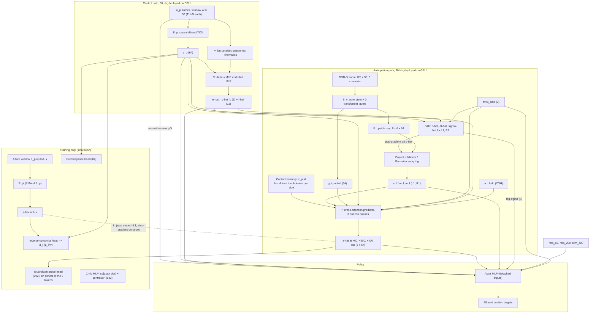

# VP-JEPA (Arm F) — Final Deep-Learning Architecture

2026-10-04 · consolidated from `VP-JEPA_Architecture.md` (v7), `VP-JEPA — Shared Training Paradigm & Baseline
Specification.md` (v2) and the implemented state in `research_progress.md` / `source/hexasim/hexasim/rl/s1/`.

**Scope.** Only the proposed model, arm **F**: its encoders, heads, JEPA computation graph, probes, critic, losses and
gradient routing. The baseline and ablation arms (O, B0, B1-K, B1-M, B2, B3), rewards, terrain, rendering and statistics
are not described here; they appear only where they fix a dimension or a rule of F.

**Authority.** This file is a derived view. The two specs stay authoritative; where they disagree, v2 governs (v2 §0.5).
Every place where the final design differs from v7, or where the code differs from the specs, is listed in §12.

**Status.** Implemented and trained: `E_p`, `V`, `v_kin`, the probes, VICReg, the sequence buffer, the actor/critic and
the widened layout (stage S1, five seeds). Designed, not implemented: `E_v`, FAH, sampling, contact memory, the
predictor `P`, the EMA target, `L_jepa`, `L_inv`. The blind headroom pilot that gates all vision work returned
**no-go for both oracles** (2026-10-03, research §2.3.12); whether F is built as specified is waiting on that decision.

---

## 1. One-paragraph summary

A proprioceptive TCN encoder `E_p` summarises the last 1 s of servo and IMU readings into a latent `z_p`. A CNN +
transformer vision encoder `E_v` turns one RGB-D frame into a patch-feature map. A foothold anticipation head (FAH)
predicts where and when each front foot will land; the feature map is sampled at those two points. A cross-attention
predictor `P` takes the sampled foothold features, the global image feature, `z_p`, the held action, the command and a
short contact memory, and predicts the **future proprioceptive latent** at three horizons (60 / 200 / 400 ms). Its
training target is the output of an EMA copy of `E_p` on the real future window (JEPA: prediction in latent space, no
reconstruction). The three predicted latents enter the PPO actor as tokens, together with how much lead time each still
has. Privileged simulator quantities reach the model only through a separate critic and through probe heads that are
discarded at deployment.

---

## 2. Notation and rates

| Symbol | Meaning | Shape |
| --- | --- | --- |
| `o_p^t` | per-step proprioceptive frame | 111 |
| `z_p^t` | proprioceptive latent, `E_p(o_p^{t−49..t})` | 64 |
| `z̄_p^{t+k}` | target latent from the EMA encoder `E_p'` | 64 |
| `ẑ_p^{t+k}` | predicted latent, k ∈ {60, 200, 400} ms = {3, 10, 20} steps | 3 × 64 |
| `ê` | `[v̂_b (3), f̂ (6 × 2)]` | 15 |
| `F_t`, `g_t` | patch map and pooled global feature from `E_v` | 8 × 6 × 64, 64 |
| `p̂_ℓ`, `Δt̂_ℓ`, `σ̂_ℓ` | FAH: touchdown position (body frame), time, uncertainty; ℓ ∈ {L1, R1} | 3, 1, 4 |
| `v_ℓ`, `m_ℓ` | feature sampled at the predicted foothold, and its validity bit | 64, 1 |
| `rem_k` | normalised remaining lead time of horizon k | 3 |
| `twist_cmd` | commanded (v_x, v_y, ω_z) | 3 |
| `P` (contract) | privileged critic input | 683 |

| Loop | Rate | Contents |
| --- | --- | --- |
| Control | 50 Hz (20 ms) | bus read → `E_p` → `V` → `π` → write |
| Anticipation | 30 Hz (33 ms) | `E_v` → FAH → sampling → `P` |

The loops are asynchronous: the actor uses the most recent `ẑ` and is told its age through `rem_k` (§7.2).

---

## 3. Computation graph



Solid arrows into the actor are value-only: every latent enters the actor detached, so PPO never trains an encoder.

---

## 4. Proprioceptive path (control loop)

### 4.1 Per-step frame `o_p` (111-D)

| Block | Dim | Source |
| --- | --- | --- |
| Joint positions `q` (relative to rest) | 18 | servo read, 10-bit quantised, ZOH-filled |
| Joint velocities `q̇` | 18 | `(q_t − q_{t−2}) / 2Δt` on the ZOH-filled positions; if either endpoint is held, hold the last valid `q̇`; no recursive filter |
| Tracking error `q_cmd − q_meas` | 18 | software; the load proxy (no `Present Load`, no PhysX torque) |
| Previous action | 18 | |
| IMU linear acceleration | 3 | |
| IMU angular velocity | 3 | |
| Body-frame gravity | 3 | |
| Clock sin/cos × 6 legs | 12 | present in S1; dropped per episode 0 → 100 % over the first 30 % of S2; permanently zero afterwards (99 live dims) |
| Read-validity mask | 18 | 1 = fresh read, 0 = held value |

Dropped reads are per servo with probability rising with servo load. One fill implementation is shared by simulation and
robot. The clock dims stay in the layout and are zeroed, never deleted, so weights stay valid.

### 4.2 Encoder `E_p` — implemented (`rl/s1/tcn.py`)

- Input: the last **W = 50** frames (1.0 s), standardised with fixed statistics (`probe_stats_pi_s0.pt`).
- 4 residual blocks, dilations {1, 2, 4, 8}, kernel 3, hidden width 128, causal padding.
- Each block: two causal convolutions with ELU, plus a residual path (1 × 1 conv when the width changes).
- Receptive field `RF = 1 + 2·(k − 1)·Σd = 61 ≥ W`, asserted at construction.
- Output: features of the newest time step → Linear(128 → 64) → LayerNorm → `z_p ∈ R^64`.
- Rollout inference runs in fp16 autocast; training and the `V` tests run in fp32.

### 4.3 Velocity and force estimator `V` — implemented (`rl/s1/aux.py`, `kinematics.py`)

```
v̂_b = v_kin + Δv̂,   Δv̂ = MLP(z_p) ∈ R³        f̂ = MLP(z_p) ∈ R^{6×2}        ê = [v̂_b, f̂] ∈ R^15
```

- `v_kin` is analytic and deployable. Each foot gives `v_b = −(J_ℓ q̇_ℓ + ω × p_ℓ)` at the toe point; `v_kin` is the
  weighted mean over feet.
- Stance weight per foot: `w = σ((|e_femur| + |e_tibia| − τ_e)/s) × σ((z̄_plane − z_toe + δ)/5 mm)`. The first factor
  reads stance-load sag from the tracking error; the second compares the toe with a plane fitted to all six toes. No
  contact switches. Constants (sim-calibrated, D26): τ_e 0.005, s 0.003, δ −0.005.
- `Δv̂` therefore has to come from what kinematics does not contain (the IMU), which makes it an explicit slip estimate.
- `f̂`: per-foot normal and tangential force magnitude, surface-normal projected.
- Both MLPs: 64 → 128 → 128 → out, ELU.
- Retained at inference; feeds FAH, `P` and the actor.

**Gate before anything downstream trains on `V`** (v7 §4.3): slip-stratified error < 3 × rigid-ground error, and zeroing
the 9 IMU dims raises the error ≥ 1.5 ×. Measured on five S1 seeds: slip/rigid 2.24 ± 0.08 ×, IMU-zero 8.3 ± 2.3 ×.

---

## 5. Vision and anticipation path (designed, not implemented)

### 5.1 Vision encoder `E_v`

| Item | Value |
| --- | --- |
| Input | 128 × 96, **5 channels**: RGB (3), inverse depth (1), depth-validity mask (1). A 6th FK self-occlusion mask channel is optional and must be decided before `E_v` trains |
| Depth | colour-aligned, clipped to [Z_min, 3.0] m; validity computed after alignment |
| Stem | 4 stride-2 conv blocks, widths 32 / 64 / 128 / 192 → 8 × 6 grid |
| Head | 3 transformer layers, d = 192, 3 heads, 48 tokens |
| Output | patch map `F_t ∈ R^{8×6×64}` and pooled `g_t ∈ R^64` |

A CNN stem rather than a ViT: TensorRT optimises convolutions better at this scale and locality suits terrain texture.
One image operator is shared by simulation and robot: anisotropic resize to 128 × 96 with no crop, RGB by area
averaging, depth by the median of valid pixels, validity = valid fraction > 0.5.

### 5.2 Foothold anticipation head (FAH)

- Inputs: `z_p^t`, `twist_cmd`, `v̂_b`, current foot positions in the body frame (from forward kinematics). No clock:
  gait phase must be inferred from `z_p`.
- Outputs per front leg ℓ ∈ {L1, R1}: touchdown position `p̂_ℓ ∈ R³` (body frame), time to touchdown `Δt̂_ℓ`, and
  heteroscedastic `σ̂_ℓ` over (x, y, z, Δt).
- Internals (depth, width, activation): **TBD**.
- Supervision: ground-truth touchdown position and time from the simulator contact sensor, Gaussian NLL (`L_fah`).
  Plain NLL (v7) or β-NLL as for the probes: **TBD**.
- FAH receives gradient from `L_fah` only. `p̂` is stop-gradiented into the sampling step.
- Retained at inference.

### 5.3 Foothold sampling

1. Project `p̂_ℓ` into the current image with the fixed extrinsics `T_{C←B}` and the post-resize intrinsics
   (`f_x ≠ f_y`).
2. Sample `F_t` bilinearly with a Gaussian kernel whose width scales with `σ̂_ℓ` (projected per axis) → `v_ℓ ∈ R^64`.
3. Validity `m_ℓ = 1` iff the point is in frame **and** in valid depth range **and** depth-consistent (not occluded by a
   nearer surface; a ray-vs-capsule test against the robot's own links covers self-occlusion). A `σ̂_ℓ` above a
   threshold also sets `m_ℓ = 0`; the threshold value is **TBD**.
4. A bounded learned pixel residual (±2 patches, `tanh`, zero-init) absorbs extrinsics calibration error. It is the
   only part of sampling that learns, and it is trained by the downstream losses.

Only the two front legs are sampled: middle and rear footholds were last seen 1–3.5 s ago and cannot be retrieved
without drift-free odometry, which is deliberately not built.

### 5.4 Phase-indexed contact memory (CM)

- On every front-leg touchdown, push `z_p` at contact plus elapsed time into a FIFO holding the last 4 contacts per side.
- Fed to `P` as ≈ 8 extra tokens of dim 64, tagged same-side / opposite-side and with elapsed time.
- This is what lets the trailing legs benefit: the middle leg lands roughly where the same side's front leg landed half
  a cycle earlier. No pose estimate, no spatial index.

### 5.5 Predictor `P` (the JEPA predictor)

| Item | Value |
| --- | --- |
| Type | cross-attention transformer, 3 layers, d = 128, 4 heads |
| Queries | 3 learned horizon tokens, one per k ∈ {60, 200, 400} ms |
| Keys / values | `v_L1 ⊙ m_L1`, `v_R1 ⊙ m_R1`, `g_t`, `z_p^t`, `a^t` (zero-order hold), `twist_cmd`, `v̂_b`, `σ̂`, `Δt̂`, CM tokens |
| Output | `ẑ_p^{t+k} ∈ R^64` per horizon |
| Token projections into d = 128 (64-D and scalar inputs), type / side embeddings | **TBD** |

Action conditioning is a zero-order hold of the current action; the policy is not rolled out inside the predictor.
`z_p` is zeroed in the predictor input (never in the actor input) on 10 % of episodes as modality dropout.

---

## 6. JEPA objective

### 6.1 Target network

`E_p'` is an exponential moving average of `E_p` (momentum 0.996 → 0.9999), used only in training, receiving no
gradient. The target for horizon k is `z̄_p^{t+k} = E_p'(o_p^{t+k−49 .. t+k})`: the latent the real future window
produces. The target is not privileged — it is a function of deployable signals.

### 6.2 Losses specific to F

- **`L_jepa`** = Σ_k smooth-L1(`ẑ_p^{t+k}`, sg[`z̄_p^{t+k}`]).
- **`L_inv`** — inverse dynamics: predict `a^t` from (`z_p^t`, `z̄_p^{t+k}`), where `z̄` is the EMA target, not the
  predictor output (decided 2026-10-04). Its gradient reaches `E_p` only; it never reaches `P` or `E_v`. Anti-collapse
  anchor: it keeps action-relevant information in `z_p`. Head internals: **TBD**.
- **`L_vic`** — VICReg variance + covariance on the batch of `z_p` (no invariance term: there is one view).

These three, the horizon queries and the EMA target are exactly what F has beyond the foothold-attended fusion without
a predictor; nothing else may differ between the two.

### 6.3 Target validity

A 400 ms horizon is 20 steps and a PPO rollout is 16 steps, so targets cannot come from the rollout. All auxiliary
losses train from a per-env **sequence buffer** (L = 128 steps = W 50 + 62-step touchdown-label horizon + margin),
decoupled from PPO. A sample is used only if all its targets are resolved and no reset lies in `[t − W, t + k_max]`.

### 6.4 Collapse and shortcut checks

- VICReg per-dim std stays above threshold.
- `L_jepa` ≤ 0.9 × the copy-last baseline (`ẑ^{t+k} := z_p^t`) at every horizon. On a quasi-periodic gait a predictor
  that copies the current latent looks converged; this check is the one that catches it.
- Self-prediction diagnostic: linear probe from `ẑ^{+400}` to `a_{t+19}`, R² reported. `E_p`'s input contains past
  actions, so the target partly encodes the policy's own future actions.

---

## 7. Policy

### 7.1 Actor

MLP, hidden [256, 128, 64], ELU, own observation normaliser, Gaussian output with a learned state-independent std
(18 values). Output: 18 joint position targets (scale 0.5 around the rest pose, clipped to the servo limits). No
residual controller.

The actor was widened once, at S1, to the union layout of all arms: first layer `W′ = [W | 0]`, so new blocks start
with zero columns. Blocks an arm does not read are held at exactly zero, so their columns get zero gradient and stay
zero. Layout source of truth: `mdp/layout.py`.

| Block (layout order) | Dim | Arm F at deployment |
| --- | --- | --- |
| `o_p^t` (q, q̇, tracking error, last action, IMU acc, gyro, gravity, clock, read mask) | 111 | live (clock dims zero) |
| `V_0` (legacy velocity input of π_S0) | 3 | zero (retired in S1) |
| `twist_cmd` | 3 | live |
| `z_p` | 64 | live |
| `ê` | 15 | live |
| M* material strips (oracle only) | 576 | zero |
| `z_s`, `z_F` (KiVi-matched arm only) | 20 | zero |
| Three output tokens `ẑ^{+60}`, `ẑ^{+200}`, `ẑ^{+400}` | 192 | live |
| `v_ℓ ⊙ m_ℓ` for L1, R1 | 128 | live |
| `m_ℓ` | 2 | live |
| `σ̂_ℓ` as log-σ of (x, y, z, Δt) | 8 | live |
| `rem_60`, `rem_200`, `rem_400` | 3 | live |
| H* height strips (geometry oracle only) | 144 | zero |
| **Total** | **1,269** | **526 live** |

Every live element is computable onboard. LayerNorm is applied per latent block, never over the concatenated input.

### 7.2 Staleness inputs

```
rem_k = clip((k − latent_age) / k, −0.5, 1.0)      k ∈ {60, 200, 400} ms
```

1.0 = fresh, 0 = expired, negative = stale. One value per horizon token, because each token loses lead time from a
different starting budget. Hard cutoff: past ≈ 150 ms of age (or `rem_400 < −0.5`) force `m_L1 = m_R1 = 0` and zero the
`ẑ` tokens.

### 7.3 Critic (training only)

- Fully separate network: MLP [512, 256, 128], ELU, own normaliser, nothing shared with the actor.
- Input: sg[actor observation] ⊕ contract **P** (683-D) → 1,952-D at S2.
- P is identical for every arm, computed at step t and independent of the action.

| Contract P element | Dim |
| --- | --- |
| True base linear velocity, body frame | 3 |
| True base height above local terrain | 1 |
| Contact force per foot, normal and tangential (surface-normal projected) | 12 |
| Contact state per foot | 6 |
| Material strips: per leg 8 × 3 points (−6 … +15 cm forward, ±3 cm lateral, 3 cm spacing) at the **nominal** foothold; μ_s, μ_d, log k, log c | 576 |
| Height scan around the body, 11 × 7 at 5 cm | 77 |
| Dynamics-randomisation parameters | 8 |

The strips sit at the rest-pose toe position, not at the actual touchdown: the actual landing point depends on future
actions and would make the baseline action-dependent.

---

## 8. Probes (training only, discarded at deployment)

One universal target set, 186-D, the same for every arm, so F's only extra training signal is self-supervised.

| Group | Per leg, × 6 | Dim | Loss |
| --- | --- | --- | --- |
| Current | contact state | 6 | BCE |
| Current | μ_s, μ_d, log k, log c under the foot | 24 | β-NLL |
| Current | local height, 3 × 3 grid at 4 cm | 54 | β-NLL |
| Next touchdown | touchdown position, body frame | 18 | β-NLL |
| Next touchdown | time to touchdown | 6 | β-NLL |
| Next touchdown | μ_s, μ_d, log k, log c at the **ground-truth** touchdown point | 24 | β-NLL, weight 2× |
| Next touchdown | local height 3 × 3 at the ground-truth touchdown point | 54 | β-NLL |

- **Current head** (84 outputs) reads `z_p`.
- **Touchdown head** (102 outputs) reads `concat(ẑ^{+60}, ẑ^{+200}, ẑ^{+400})` (192-D) in arm F. In the blind S1 trunk
  it reads `z_p`. This is what forces the predicted latents, and through them the visual path, to carry contact physics.
- Head: Linear → 256 → ELU → Linear, outputting a mean and a log-variance per target.
- Loss: `L_β = sg[σ^{2β}] · (½ log σ² + (y − μ)² / 2σ²)`, β = 0.5, log σ² clamped to [−6, 4]. Targets standardised with
  fixed statistics from a π_S0 rollout.
- Weight: constant from the start of S1 to the end of S3. No anneal.
- All six legs are supervised; the trailing-leg targets train the proprioception-propagated half of the cascade.
- Touchdown targets are written retroactively in the sequence buffer; samples whose touchdown lies past an episode end
  are masked.

Health check for S3: the predicted σ of leading-leg touchdown friction must fall within the first 30 % of S3; if not,
the RGB path is not learning.

---

## 9. Losses and gradient routing

```
L_aux = λ_est·L_est + λ_probe·L_probe + λ_vic·L_vic + λ_fah·L_fah + λ_jepa·L_jepa + λ_inv·L_inv
L_PPO = surrogate + value loss − entropy        (separate optimisers; no KL anchor)
```

| Loss | Definition |
| --- | --- |
| `L_est` | Huber(Δv̂, v_true − v_kin) with sample weight `1 + 20·slip speed`, plus Huber(f̂, F) |
| `L_probe` | BCE (contact) + β-NLL (current) + β-NLL (touchdown, material ×2) |
| `L_vic` | VICReg variance + 0.04 × covariance on `z_p` |
| `L_fah` | Gaussian NLL on touchdown position and time, front legs (plain vs β-NLL: **TBD**) |
| `L_jepa` | Σ_k smooth-L1(`ẑ^{t+k}`, sg[`z̄^{t+k}`]) |
| `L_inv` | action prediction from (`z_p^t`, sg[`z̄^{t+k}`]), EMA target |

| Module | Trained by | Blocked from |
| --- | --- | --- |
| Actor `π` | PPO | every auxiliary loss |
| Critic | value loss | its inputs are detached |
| `E_p` | `L_est`, `L_probe`, `L_vic`, `L_inv` (directly), `L_jepa` (through `P`) | PPO, value loss |
| `V` | `L_est` | — |
| `E_v` | `L_probe` (touchdown head, through `P`), `L_jepa` | PPO, value loss |
| FAH | `L_fah` only | downstream losses (stop-gradient on `p̂`) |
| Sampling pixel residual | downstream losses | — |
| `P` | `L_probe` touchdown, `L_jepa` | PPO, value loss, `L_inv` |
| `E_p'` (EMA) | nothing | — |

Merge-gating unit tests: value-loss backward leaves every actor-side grad `None`; PPO backward leaves every encoder grad
`None`; `L_probe` / `L_jepa` leave FAH grads `None`; the widened actor equals the pre-widening actor to < 1e-6 over
10,000 random observations; TCN asserts RF ≥ W.

**Latent drift.** Latents are stored detached at collection time while auxiliary updates move the encoders. Mitigation:
LayerNorm on every latent block entering the actor, encoder learning rate ≈ 0.3 × the heads', per-block input statistics
logged every iteration.

---

## 10. Optimisation settings

| | Value | Source |
| --- | --- | --- |
| PPO batch | 4,096 envs × 16 steps (S1); `N_v × T_v` with `N_v·T_v ≥ 24,576` in S2/S3, `N_v` unmeasured | spec §1, §6.2 |
| γ / λ / clip | 0.99 / 0.95 / 0.2 | code |
| Epochs × minibatches | 5 × 4 | code |
| Actor LR / critic LR | 1e-4 fixed / 3e-4 | code |
| Entropy coefficient / grad clip | 0.0005 / 1.0 | code |
| Mirror augmentation | left–right, every minibatch; latents recomputed on the mirrored history | code |
| Aux optimiser | Adam; heads 1e-3, `E_p` 3e-4; grad clip 1.0; fp16 mixed precision | code |
| Aux batch | 4,096 samples × 8 minibatches per PPO iteration | code |
| Aux weights | λ_est 1.0, λ_probe 1.0, λ_vic 0.1 | code |
| λ_fah, λ_jepa, λ_inv | **TBD** | — |
| EMA schedule length | not yet fixed | — |

---

## 11. When each part trains, and what deploys

| Stage | Goes live for arm F |
| --- | --- |
| S1 (done) | `E_p`, `V`, current + touchdown probes on `z_p`, VICReg; actor reads `o_p`, `z_p`, `ê`, `twist_cmd`; clock visible |
| S2 (depth) | `E_v` on depth + validity, FAH, sampling, CM, `P`, EMA target, `L_jepa`, `L_inv`; touchdown probe moves to the `ẑ` tokens; clock dropped per episode over the first 30 % |
| S3 (RGB-D, main stage) | RGB channels introduced by channel dropout 100 % → 10 % over the first 30 %; this is the only stage where visual friction anticipation can be learned |

When a block goes live, its critic normaliser statistics must be set, its first-layer columns zeroed and the Adam
second moment of those columns seeded; otherwise the critic sees noise × 100 and the actor is wrecked by sign-steps
(found on the blind arms, research §2.3.9).

| Retained at inference | Discarded |
| --- | --- |
| `E_p`, `V` (+ `v_kin`), `E_v`, FAH, sampling, CM, `P`, `π` | `E_p'`, inverse-dynamics head, both probe heads, critic |

| Path | Components | Device | Budget |
| --- | --- | --- | --- |
| Control | `E_p` + `V` + `π` | CPU, FP32 | ≤ 1.5 ms at 50 Hz |
| Anticipation | `E_v` (INT8) + FAH + sampling + `P` (FP16) | GPU, TensorRT | ≤ 15 ms of 33 ms at 30 Hz |

---

## 12. Deviations that matter

### 12.1 v2 overrides of v7 (the final design follows v2)

| Topic | v7 | Final |
| --- | --- | --- |
| TCN window | 25 steps | **50**, RF 61 asserted |
| Joint velocity | "finite-differenced + filtered" | two-sample difference of ZOH positions, no filter |
| `V` | `v̂_b` (or residual) | residual `v_kin + Δv̂` **plus** contact-force estimate `f̂`; stance set from tracking error + toe-plane fit |
| Probe target location | predicted touchdown | **ground-truth** touchdown; touchdown head reads the concatenated tokens |
| Probe loss | Gaussian NLL / unspecified | β-NLL, β = 0.5 |
| Probe weight | 0 in stage 1, max in stage 3, cosine → 0 | constant S1 → end of S3 |
| Critic physics input | actual touchdown location | action-independent strips at the nominal foothold (contract P) |
| Critic input | "actor obs + privileged" vs "own encoder" | sg[actor obs] ⊕ P, separate MLP |
| Clock-phase reward floors after the clock leaves | kept at 10–15 % | removed with the clock; phase-free contact-conditioned terms survive |
| Clock dropout granularity | unspecified | per episode, never per step |
| Camera geometry | depth FOV, pitch 35–40° | colour FOV 69° × 42°, pitch 45–50°, no crop |
| SSL data | FIFO buffer | per-env ring buffer L = 128 + episode masking |

### 12.2 Decisions made during implementation

| # | Deviation | Effect on F |
| --- | --- | --- |
| Warm start dropped (2026-09-23) | π_S0 is trained from scratch; no KL anchor anywhere | no `L_KL` term in any stage |
| D1 | batch 4,096 × 16, not 8,192 × 16 | S1 batch |
| D21 / D35 | left–right mirror augmentation in every stage; colour optic on the sagittal plane, depth corruption after mirroring | constrains the camera mount and the vision data path |
| D23 | legacy `V_0` kept as a frozen column in S1 and retired per episode once `V` passes its tests | 3 permanently-zero actor dims |
| D26 | `v_kin` stance constants calibrated in simulation | to be recalibrated on bench data |
| D32 | W = 50 kept although the sweep rule selected no window (W 25 better on `V`, worse on both probes) | blind metrics cannot see what a longer window buys once the clock leaves |
| D37 / D40 | 144-D H* block appended; layout 1,125 → 1,269 | zero-held in F |
| D38 | primary behaviour metrics are transition-window tracking / slip / falls and first-contact impact; stride is descriptive | changes what F is judged on, not the network |
| D39 | two soft-ground material entries (12-entry library from S2) | wider range for the log-k probe targets |

### 12.3 Code vs spec (small, to be reconciled or reported)

| Item | Spec | Code |
| --- | --- | --- |
| `Δv̂` MLP | "two-layer MLP" | 64 → 128 → 128 → 3 (two hidden layers) |
| Probe head | "2-layer MLP, 256 hidden" | one hidden layer of 256 |
| Frame block order | mask listed last, clock before it | same content; order per `mdp/layout.py` |

### 12.4 Open or under-specified in the specs

1. **Headroom gate.** The blind oracle pilot found no anticipation headroom for material or geometry foresight
   (2026-10-03). By spec §11 no vision run starts until this is resolved; the vision half of this document is a design.
2. **`L_inv` routing — resolved 2026-10-04.** v7 §4.11's definition is final: `L_inv` reads (`z_p^t`, `z̄^{t+k}`) and
   trains `E_p` only. v2 §8.2 listed `P` as receiving `L_inv` gradient, which would need `ẑ^{t+k}` as an input and
   which `P` could satisfy by copying its own `a^t` input; that row is corrected in the spec.
3. **Token projections — TBD.** `E_v`, `z_p` and CM tokens are 64-D, `P` runs at d = 128; the per-token input
   projections and the type / side embeddings are not specified.
4. **FAH internals and inverse-dynamics head internals — TBD.**
5. **σ threshold for `m_ℓ` — TBD.**
6. **`E_v` channel count** (5 vs 6) must be frozen before `E_v` trains.
7. **`L_fah` form — TBD.** v7 says Gaussian NLL; v2's β-NLL is stated for the probes only.
8. **λ_fah, λ_jepa, λ_inv — TBD.**
9. **Unmeasured inputs:** `N_v`, `latent_age` p99, `Z_min`, L1/R1 toe lateral offset, rolling-shutter readout time.
